# obj-codec benchmark report

来源: `main.json`

| | |
| --- | --- |
| 时间 | 2026-10-29T08:26:47.019Z |
| Node | v24.16.0 |
| 平台 | linux 7.2.11-arch1-1 x64 |
| CPU | 13th Gen Intel(R) Core(TM) i7-13650HX |
| git | 7682a98 |
| 参数 | seed=1 time=250ms warmup=100ms iterations=2 timeout=30000ms |

口径：`ops/s` 来自 tinybench 的平均单次耗时（`1000/mean`），`MB/s` 用编码载荷字节数折算；`structuredClone` 不产生线格式，体积与解码列为空。S5 使用单发模式（每个 case 一次编码、一次解码），其 `ops/s` 是单次采样的倒数。

图表读法：所有排行图都按「越靠上越好」排序，标签前的数字是名次；`obj-codec` 用橙色标出，其余为蓝色。每节的完整数值收在折叠块里。

## 套件 S0

### 汇总（跨数据集几何均值）

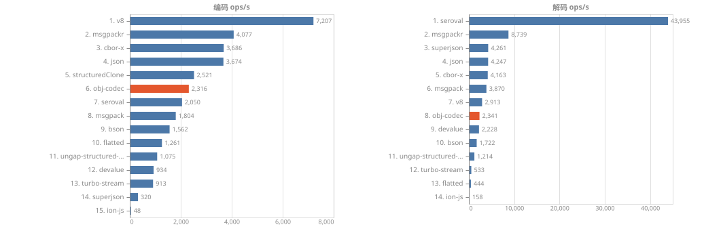

汇总数值

| 库 | 编码 ops/s | 解码 ops/s | vs JSON (enc) | vs JSON (dec) | 参与数据集 | 失败 |
| --- | ---: | ---: | ---: | ---: | ---: | ---: |
| v8 | 7,081 | 2,869 | 1.93x | 0.67x | 10 | 0 |
| msgpackr | 4,022 | 8,671 | 1.10x | 2.02x | 10 | 0 |
| json | 3,673 | 4,287 | 1.00x | 1.00x | 10 | 0 |
| cbor-x | 3,639 | 4,102 | 0.99x | 0.96x | 10 | 0 |
| structuredClone | 2,531 | - | 0.69x | - | 10 | 0 |
| seroval | 2,030 | 43,689 | 0.55x | 10.19x | 10 | 0 |
| obj-codec | 1,826 | 1,053 | 0.50x | 0.25x | 10 | 0 |
| msgpack | 1,782 | 3,889 | 0.49x | 0.91x | 10 | 0 |
| bson | 1,606 | 1,745 | 0.44x | 0.41x | 10 | 0 |
| flatted | 1,252 | 435 | 0.34x | 0.10x | 10 | 0 |
| ungap-structured-clone | 1,050 | 1,205 | 0.29x | 0.28x | 10 | 0 |
| devalue | 926 | 2,177 | 0.25x | 0.51x | 10 | 0 |
| turbo-stream | 898 | 522 | 0.24x | 0.12x | 10 | 0 |
| superjson | 316 | 4,176 | 0.09x | 0.97x | 10 | 0 |
| ion-js | 48 | 154 | 0.01x | 0.04x | 10 | 0 |

### 分数据集吞吐

分数据集明细（10 个数据集，各含图表与完整数值）

**A01-ints — 整数数组 1e4**

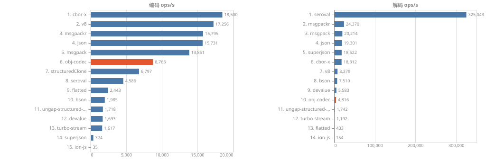

| 库 | 编码 ops/s | 解码 ops/s | 编码 MB/s | 解码 MB/s | enc p75 (ms) | dec p75 (ms) | 样本 | enc RME | 相对 JSON (enc) |
| --- | ---: | ---: | ---: | ---: | ---: | ---: | ---: | ---: | ---: |
| cbor-x | 18,435 | 18,263 | 537.63 | 532.59 | 0.056 | 0.054 | 4609 | 0.8% | 1.18x |
| v8 | 17,334 | 8,213 | 516.85 | 244.90 | 0.060 | 0.116 | 4334 | 0.5% | 1.11x |
| msgpackr | 15,774 | 24,180 | 458.13 | 702.27 | 0.065 | 0.041 | 3944 | 1.1% | 1.01x |
| json | 15,620 | 19,185 | 728.98 | 895.39 | 0.071 | 0.052 | 3905 | 0.4% | 1.00x |
| msgpack | 13,832 | 20,374 | 399.08 | 587.81 | 0.076 | 0.048 | 3459 | 1.6% | 0.89x |
| structuredClone | 6,851 | - | - | - | 0.147 | - | 1713 | 0.3% | 0.44x |
| seroval | 4,697 | 320,203 | 219.20 | 14944.21 | 0.199 | 0.003 | 1175 | 3.1% | 0.30x |
| obj-codec | 4,354 | 1,277 | 129.02 | 37.83 | 0.234 | 0.796 | 1089 | 1.8% | 0.28x |
| flatted | 2,466 | 436 | 115.12 | 20.34 | 0.412 | 2.267 | 617 | 0.4% | 0.16x |
| bson | 2,122 | 7,568 | 209.89 | 748.51 | 0.481 | 0.129 | 531 | 1.3% | 0.14x |
| ungap-structured-clone | 1,740 | 1,771 | 143.48 | 146.04 | 0.534 | 0.544 | 436 | 3.2% | 0.11x |
| devalue | 1,650 | 5,599 | 109.00 | 369.85 | 0.571 | 0.177 | 413 | 3.0% | 0.11x |
| turbo-stream | 1,569 | 1,160 | 73.24 | 54.13 | 0.643 | 0.852 | 393 | 3.2% | 0.10x |
| superjson | 372 | 17,859 | 17.34 | 833.66 | 2.704 | 0.054 | 93 | 4.1% | 0.02x |
| ion-js | 37 | 153 | 1.08 | 4.48 | 30.161 | 6.362 | 10 | 12.7% | 0.00x |

**A02-floats — 浮点数组 1e4**

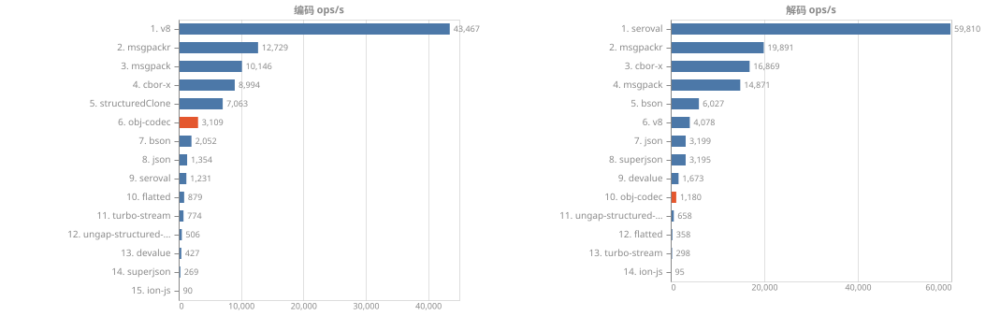

| 库 | 编码 ops/s | 解码 ops/s | 编码 MB/s | 解码 MB/s | enc p75 (ms) | dec p75 (ms) | 样本 | enc RME | 相对 JSON (enc) |
| --- | ---: | ---: | ---: | ---: | ---: | ---: | ---: | ---: | ---: |
| v8 | 43,467 | 4,078 | 3912.47 | 367.08 | 0.021 | 0.177 | 10867 | 4.1% | 32.10x |
| msgpackr | 12,729 | 19,891 | 1145.68 | 1790.26 | 0.077 | 0.049 | 3183 | 0.8% | 9.40x |
| msgpack | 10,146 | 14,871 | 913.17 | 1338.40 | 0.094 | 0.066 | 2537 | 1.0% | 7.49x |
| cbor-x | 8,994 | 16,869 | 809.49 | 1518.26 | 0.109 | 0.058 | 2249 | 0.6% | 6.64x |
| structuredClone | 7,063 | - | - | - | 0.141 | - | 1766 | 0.5% | 5.22x |
| obj-codec | 3,109 | 1,180 | 279.89 | 106.26 | 0.304 | 0.865 | 778 | 2.7% | 2.30x |
| bson | 2,052 | 6,027 | 285.05 | 837.18 | 0.495 | 0.162 | 514 | 1.0% | 1.52x |
| json | 1,354 | 3,199 | 256.45 | 605.90 | 0.737 | 0.315 | 339 | 0.9% | 1.00x |
| seroval | 1,231 | 59,810 | 233.18 | 11328.29 | 0.812 | 0.016 | 308 | 3.1% | 0.91x |
| flatted | 879 | 358 | 166.52 | 67.75 | 1.135 | 2.820 | 221 | 1.0% | 0.65x |
| turbo-stream | 774 | 298 | 146.61 | 56.47 | 1.335 | 3.339 | 194 | 3.0% | 0.57x |
| ungap-structured-clone | 506 | 658 | 140.69 | 183.20 | 2.096 | 1.411 | 127 | 3.3% | 0.37x |
| devalue | 427 | 1,673 | 101.80 | 398.75 | 2.373 | 0.671 | 107 | 5.9% | 0.32x |
| superjson | 269 | 3,195 | 50.97 | 605.19 | 3.783 | 0.314 | 68 | 3.9% | 0.20x |
| ion-js | 90 | 95 | 8.07 | 8.53 | 13.806 | 11.790 | 23 | 15.6% | 0.07x |

**A03-short-strings — 短字符串记录 2e3**

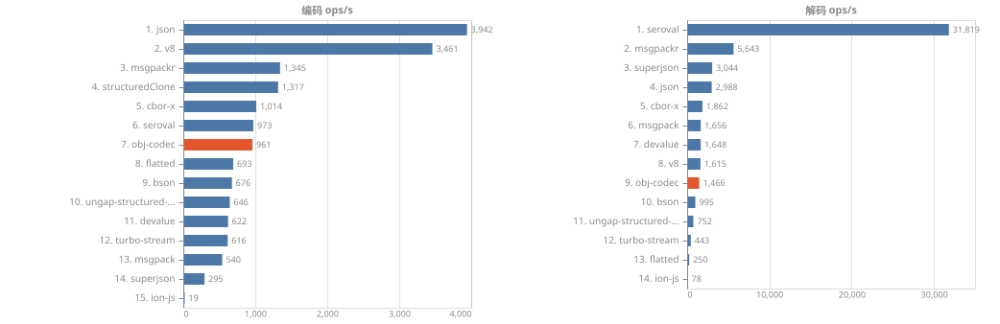

| 库 | 编码 ops/s | 解码 ops/s | 编码 MB/s | 解码 MB/s | enc p75 (ms) | dec p75 (ms) | 样本 | enc RME | 相对 JSON (enc) |
| --- | ---: | ---: | ---: | ---: | ---: | ---: | ---: | ---: | ---: |
| json | 4,035 | 2,996 | 634.94 | 471.44 | 0.243 | 0.332 | 1009 | 1.2% | 1.00x |
| v8 | 3,379 | 1,535 | 457.47 | 207.74 | 0.309 | 0.602 | 845 | 3.7% | 0.84x |
| structuredClone | 1,333 | - | - | - | 0.740 | - | 334 | 0.6% | 0.33x |
| msgpackr | 1,327 | 5,565 | 102.37 | 429.30 | 0.758 | 0.172 | 332 | 0.5% | 0.33x |
| cbor-x | 1,016 | 1,798 | 125.17 | 221.38 | 0.989 | 0.547 | 255 | 0.6% | 0.25x |
| seroval | 947 | 30,650 | 129.07 | 4178.24 | 1.088 | 0.033 | 237 | 2.9% | 0.23x |
| obj-codec | 813 | 609 | 71.97 | 53.88 | 1.270 | 1.703 | 204 | 3.9% | 0.20x |
| flatted | 694 | 251 | 119.38 | 43.11 | 1.412 | 4.089 | 174 | 1.5% | 0.17x |
| bson | 670 | 1,013 | 110.14 | 166.50 | 1.489 | 1.009 | 168 | 1.1% | 0.17x |
| devalue | 619 | 1,656 | 100.27 | 268.46 | 1.588 | 0.609 | 155 | 3.8% | 0.15x |
| ungap-structured-clone | 607 | 746 | 97.60 | 119.89 | 1.808 | 1.290 | 152 | 4.2% | 0.15x |
| turbo-stream | 593 | 436 | 93.35 | 68.67 | 1.710 | 2.274 | 149 | 2.8% | 0.15x |
| msgpack | 543 | 1,650 | 64.67 | 196.41 | 1.870 | 0.605 | 136 | 2.1% | 0.13x |
| superjson | 296 | 3,049 | 46.64 | 479.75 | 3.388 | 0.329 | 75 | 4.1% | 0.07x |
| ion-js | 20 | 78 | 1.78 | 6.95 | 58.106 | 13.639 | 5 | 31.0% | 0.00x |

**A04-long-text — 长文本 1MB**

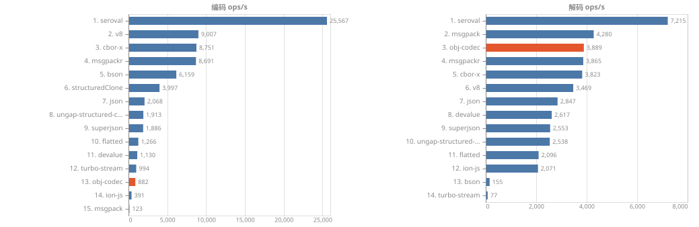

| 库 | 编码 ops/s | 解码 ops/s | 编码 MB/s | 解码 MB/s | enc p75 (ms) | dec p75 (ms) | 样本 | enc RME | 相对 JSON (enc) |
| --- | ---: | ---: | ---: | ---: | ---: | ---: | ---: | ---: | ---: |
| seroval | 25,567 | 7,215 | 24883.27 | 7022.27 | 0.039 | 0.138 | 6392 | 0.7% | 12.36x |
| v8 | 9,007 | 3,469 | 8765.98 | 3375.83 | 0.078 | 0.250 | 2252 | 4.2% | 4.36x |
| cbor-x | 8,751 | 3,823 | 8517.04 | 3720.89 | 0.083 | 0.237 | 2189 | 6.3% | 4.23x |
| msgpackr | 8,691 | 3,865 | 8458.07 | 3761.47 | 0.087 | 0.243 | 2174 | 6.2% | 4.20x |
| bson | 6,159 | 155 | 5994.35 | 150.96 | 0.258 | 6.528 | 1540 | 4.0% | 2.98x |
| structuredClone | 3,997 | - | - | - | 0.235 | - | 1000 | 1.7% | 1.93x |
| json | 2,068 | 2,847 | 2012.65 | 2770.86 | 0.479 | 0.330 | 517 | 1.3% | 1.00x |
| ungap-structured-clone | 1,913 | 2,538 | 1861.96 | 2470.69 | 0.552 | 0.393 | 479 | 2.1% | 0.93x |
| superjson | 1,886 | 2,553 | 1835.80 | 2484.74 | 0.519 | 0.373 | 472 | 2.0% | 0.91x |
| flatted | 1,266 | 2,096 | 1231.76 | 2039.76 | 0.760 | 0.423 | 317 | 2.5% | 0.61x |
| devalue | 1,130 | 2,617 | 1099.87 | 2546.62 | 0.862 | 0.358 | 283 | 2.1% | 0.55x |
| turbo-stream | 994 | 77 | 967.65 | 74.49 | 0.980 | 13.567 | 249 | 3.0% | 0.48x |
| obj-codec | 882 | 3,889 | 858.32 | 3784.76 | 1.218 | 0.233 | 221 | 5.1% | 0.43x |
| ion-js | 391 | 2,071 | 380.17 | 2015.35 | 2.635 | 0.443 | 98 | 2.9% | 0.19x |
| msgpack | 123 | 4,280 | 119.94 | 4165.36 | 8.310 | 0.212 | 31 | 1.2% | 0.06x |

**A05-wide-records — 重复 key 宽记录 1e3 x 20 字段**

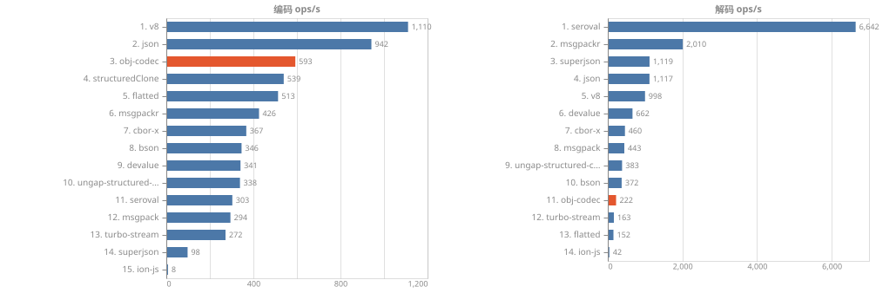

| 库 | 编码 ops/s | 解码 ops/s | 编码 MB/s | 解码 MB/s | enc p75 (ms) | dec p75 (ms) | 样本 | enc RME | 相对 JSON (enc) |
| --- | ---: | ---: | ---: | ---: | ---: | ---: | ---: | ---: | ---: |
| v8 | 1,110 | 998 | 316.29 | 284.26 | 0.906 | 0.992 | 278 | 0.7% | 1.18x |
| json | 942 | 1,117 | 304.62 | 361.25 | 1.099 | 0.896 | 236 | 1.0% | 1.00x |
| obj-codec | 593 | 222 | 71.61 | 26.83 | 1.673 | 4.389 | 149 | 4.0% | 0.63x |
| structuredClone | 539 | - | - | - | 1.838 | - | 135 | 0.9% | 0.57x |
| flatted | 513 | 152 | 163.82 | 48.45 | 1.937 | 6.722 | 129 | 1.2% | 0.54x |
| msgpackr | 426 | 2,010 | 36.98 | 174.56 | 2.355 | 0.486 | 107 | 0.6% | 0.45x |
| cbor-x | 367 | 460 | 92.98 | 116.41 | 2.736 | 2.122 | 92 | 0.7% | 0.39x |
| bson | 346 | 372 | 114.50 | 123.12 | 2.890 | 2.747 | 87 | 0.6% | 0.37x |
| devalue | 341 | 662 | 96.68 | 187.89 | 3.234 | 1.486 | 86 | 5.6% | 0.36x |
| ungap-structured-clone | 338 | 383 | 62.33 | 70.54 | 3.028 | 2.501 | 85 | 4.4% | 0.36x |
| seroval | 303 | 6,642 | 85.92 | 1881.96 | 3.499 | 0.146 | 76 | 4.0% | 0.32x |
| msgpack | 294 | 443 | 74.22 | 111.66 | 3.409 | 2.255 | 74 | 1.8% | 0.31x |
| turbo-stream | 272 | 163 | 87.94 | 52.72 | 3.661 | 6.288 | 68 | 2.2% | 0.29x |
| superjson | 98 | 1,119 | 31.60 | 361.81 | 10.443 | 0.896 | 25 | 4.5% | 0.10x |
| ion-js | 8 | 42 | 0.84 | 4.60 | 150.821 | 24.064 | 2 | 206.8% | 0.01x |

**A06-api-doc — 真实 API 文档（嵌套 5-8 层）**

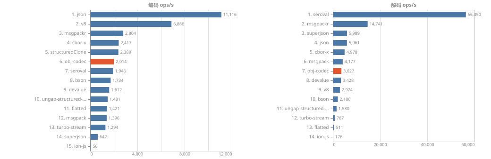

| 库 | 编码 ops/s | 解码 ops/s | 编码 MB/s | 解码 MB/s | enc p75 (ms) | dec p75 (ms) | 样本 | enc RME | 相对 JSON (enc) |
| --- | ---: | ---: | ---: | ---: | ---: | ---: | ---: | ---: | ---: |
| json | 11,212 | 5,907 | 671.59 | 353.81 | 0.089 | 0.169 | 2803 | 0.3% | 1.00x |
| v8 | 6,863 | 2,940 | 375.01 | 160.64 | 0.148 | 0.320 | 1716 | 3.4% | 0.61x |
| msgpackr | 2,826 | 14,314 | 79.86 | 404.43 | 0.351 | 0.067 | 707 | 0.5% | 0.25x |
| structuredClone | 2,535 | - | - | - | 0.391 | - | 634 | 0.4% | 0.23x |
| cbor-x | 2,462 | 5,137 | 119.71 | 249.80 | 0.405 | 0.194 | 616 | 0.6% | 0.22x |
| seroval | 2,002 | 54,136 | 105.95 | 2865.59 | 0.480 | 0.018 | 501 | 1.9% | 0.18x |
| obj-codec | 1,889 | 1,546 | 67.05 | 54.85 | 0.510 | 0.630 | 473 | 2.9% | 0.17x |
| bson | 1,762 | 2,073 | 112.97 | 132.94 | 0.557 | 0.480 | 441 | 1.0% | 0.16x |
| devalue | 1,601 | 3,236 | 107.51 | 217.27 | 0.590 | 0.300 | 401 | 2.5% | 0.14x |
| ungap-structured-clone | 1,455 | 1,579 | 100.16 | 108.68 | 0.642 | 0.613 | 364 | 3.2% | 0.13x |
| flatted | 1,408 | 516 | 102.23 | 37.47 | 0.706 | 1.921 | 352 | 0.7% | 0.13x |
| msgpack | 1,342 | 4,165 | 61.81 | 191.90 | 0.759 | 0.236 | 336 | 1.4% | 0.12x |
| turbo-stream | 1,300 | 796 | 77.87 | 47.67 | 0.785 | 1.220 | 326 | 1.9% | 0.12x |
| superjson | 633 | 5,926 | 37.95 | 355.02 | 1.566 | 0.170 | 159 | 2.5% | 0.06x |
| ion-js | 55 | 177 | 1.86 | 5.98 | 20.913 | 6.056 | 14 | 17.6% | 0.00x |

**A07-deep-chain — 深链 1e3**

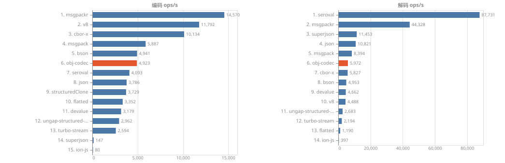

| 库 | 编码 ops/s | 解码 ops/s | 编码 MB/s | 解码 MB/s | enc p75 (ms) | dec p75 (ms) | 样本 | enc RME | 相对 JSON (enc) |
| --- | ---: | ---: | ---: | ---: | ---: | ---: | ---: | ---: | ---: |
| msgpackr | 14,266 | 43,366 | 52.94 | 160.93 | 0.069 | 0.022 | 3567 | 0.6% | 3.81x |
| v8 | 11,913 | 4,616 | 225.63 | 87.42 | 0.084 | 0.221 | 2979 | 5.8% | 3.18x |
| cbor-x | 10,250 | 5,754 | 171.41 | 96.23 | 0.096 | 0.173 | 2563 | 0.6% | 2.74x |
| msgpack | 5,905 | 8,472 | 86.32 | 123.85 | 0.165 | 0.117 | 1477 | 1.6% | 1.58x |
| bson | 5,250 | 5,041 | 115.54 | 110.96 | 0.187 | 0.192 | 1313 | 0.6% | 1.40x |
| obj-codec | 4,340 | 2,666 | 38.65 | 23.74 | 0.222 | 0.363 | 1086 | 1.7% | 1.16x |
| seroval | 3,991 | 92,486 | 67.44 | 1562.73 | 0.238 | 0.010 | 998 | 1.4% | 1.07x |
| structuredClone | 3,851 | - | - | - | 0.257 | - | 963 | 0.4% | 1.03x |
| json | 3,743 | 11,486 | 78.22 | 240.03 | 0.269 | 0.088 | 936 | 0.2% | 1.00x |
| flatted | 3,296 | 1,184 | 88.29 | 31.71 | 0.300 | 0.841 | 825 | 0.5% | 0.88x |
| devalue | 3,205 | 4,559 | 95.48 | 135.83 | 0.292 | 0.218 | 802 | 2.0% | 0.86x |
| ungap-structured-clone | 2,918 | 2,664 | 90.00 | 82.15 | 0.316 | 0.368 | 730 | 2.4% | 0.78x |
| turbo-stream | 2,475 | 2,222 | 51.71 | 46.44 | 0.404 | 0.443 | 619 | 1.8% | 0.66x |
| superjson | 144 | 10,713 | 3.02 | 223.96 | 7.321 | 0.093 | 37 | 10.1% | 0.04x |
| ion-js | 78 | 393 | 0.60 | 3.05 | 16.281 | 2.397 | 20 | 18.3% | 0.02x |

**A08-wide-object — 宽对象 2e3 key**

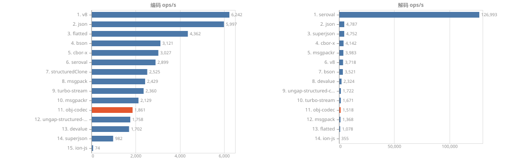

| 库 | 编码 ops/s | 解码 ops/s | 编码 MB/s | 解码 MB/s | enc p75 (ms) | dec p75 (ms) | 样本 | enc RME | 相对 JSON (enc) |
| --- | ---: | ---: | ---: | ---: | ---: | ---: | ---: | ---: | ---: |
| v8 | 6,242 | 3,718 | 181.00 | 107.80 | 0.165 | 0.250 | 1561 | 0.7% | 1.04x |
| json | 5,997 | 4,787 | 200.73 | 160.22 | 0.167 | 0.209 | 1500 | 0.3% | 1.00x |
| flatted | 4,362 | 1,078 | 129.51 | 32.00 | 0.232 | 0.934 | 1091 | 0.4% | 0.73x |
| bson | 3,121 | 3,521 | 103.18 | 116.40 | 0.322 | 0.278 | 781 | 0.7% | 0.52x |
| cbor-x | 3,027 | 4,142 | 78.30 | 107.12 | 0.334 | 0.239 | 757 | 0.5% | 0.50x |
| seroval | 2,899 | 126,993 | 85.46 | 3743.00 | 0.342 | 0.007 | 725 | 0.9% | 0.48x |
| structuredClone | 2,525 | - | - | - | 0.390 | - | 632 | 2.6% | 0.42x |
| msgpack | 2,429 | 1,368 | 62.71 | 35.32 | 0.414 | 0.729 | 608 | 0.9% | 0.40x |
| turbo-stream | 2,360 | 1,671 | 79.00 | 55.93 | 0.413 | 0.600 | 590 | 1.4% | 0.39x |
| msgpackr | 2,129 | 3,983 | 55.02 | 102.95 | 0.476 | 0.248 | 533 | 0.4% | 0.35x |
| obj-codec | 1,861 | 1,518 | 44.48 | 36.28 | 0.525 | 0.655 | 466 | 2.2% | 0.31x |
| ungap-structured-clone | 1,758 | 1,722 | 102.19 | 100.09 | 0.534 | 0.551 | 440 | 2.6% | 0.29x |
| devalue | 1,702 | 2,324 | 54.38 | 74.28 | 0.622 | 0.423 | 426 | 3.8% | 0.28x |
| superjson | 982 | 4,752 | 32.89 | 159.09 | 1.064 | 0.211 | 246 | 2.0% | 0.16x |
| ion-js | 74 | 355 | 2.21 | 10.57 | 19.992 | 2.703 | 19 | 20.5% | 0.01x |

**A09-mixed-payload — 混合真实 payload 约 1MB**

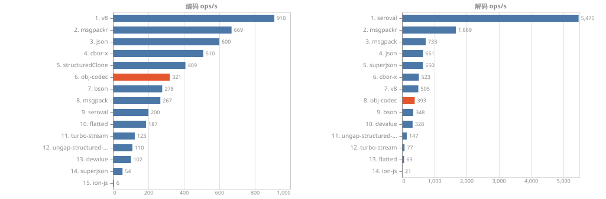

| 库 | 编码 ops/s | 解码 ops/s | 编码 MB/s | 解码 MB/s | enc p75 (ms) | dec p75 (ms) | 样本 | enc RME | 相对 JSON (enc) |
| --- | ---: | ---: | ---: | ---: | ---: | ---: | ---: | ---: | ---: |
| v8 | 918 | 502 | 378.72 | 207.07 | 1.037 | 1.935 | 230 | 12.9% | 1.51x |
| msgpackr | 669 | 1,636 | 154.96 | 379.06 | 1.534 | 0.585 | 168 | 1.8% | 1.10x |
| json | 608 | 644 | 358.59 | 379.80 | 1.646 | 1.557 | 152 | 0.9% | 1.00x |
| cbor-x | 507 | 501 | 186.54 | 184.31 | 2.009 | 2.068 | 127 | 0.6% | 0.83x |
| structuredClone | 409 | - | - | - | 2.464 | - | 103 | 0.4% | 0.67x |
| bson | 273 | 348 | 131.25 | 167.07 | 3.702 | 2.875 | 69 | 2.6% | 0.45x |
| msgpack | 257 | 726 | 92.50 | 261.06 | 3.826 | 1.330 | 65 | 6.1% | 0.42x |
| obj-codec | 255 | 150 | 72.08 | 42.43 | 3.925 | 6.524 | 64 | 5.8% | 0.42x |
| seroval | 200 | 5,473 | 108.18 | 2959.84 | 5.062 | 0.167 | 51 | 3.8% | 0.33x |
| flatted | 187 | 64 | 119.69 | 41.19 | 5.320 | 16.399 | 47 | 1.8% | 0.31x |
| turbo-stream | 124 | 82 | 73.13 | 48.33 | 7.921 | 12.910 | 31 | 4.9% | 0.20x |
| devalue | 103 | 323 | 72.76 | 227.07 | 10.245 | 3.297 | 26 | 7.4% | 0.17x |
| ungap-structured-clone | 101 | 144 | 75.50 | 107.46 | 10.771 | 6.268 | 26 | 6.7% | 0.17x |
| superjson | 54 | 650 | 31.65 | 383.23 | 20.828 | 1.534 | 14 | 7.3% | 0.09x |
| ion-js | 6 | 19 | 1.50 | 5.08 | 175.585 | 51.488 | 2 | 8.9% | 0.01x |

**A10-bool-null — 布尔/null 密集 1e4**

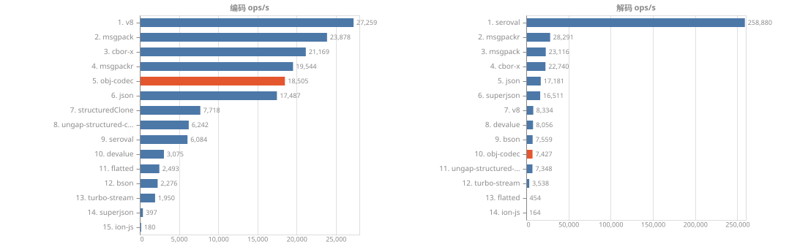

| 库 | 编码 ops/s | 解码 ops/s | 编码 MB/s | 解码 MB/s | enc p75 (ms) | dec p75 (ms) | 样本 | enc RME | 相对 JSON (enc) |
| --- | ---: | ---: | ---: | ---: | ---: | ---: | ---: | ---: | ---: |
| v8 | 26,564 | 8,394 | 265.87 | 84.02 | 0.038 | 0.115 | 6641 | 3.2% | 1.51x |
| msgpack | 23,590 | 23,814 | 235.97 | 238.21 | 0.043 | 0.041 | 5898 | 1.5% | 1.34x |
| msgpackr | 19,587 | 28,557 | 195.92 | 285.66 | 0.052 | 0.034 | 4897 | 0.8% | 1.11x |
| cbor-x | 19,372 | 22,568 | 193.78 | 225.74 | 0.052 | 0.044 | 4844 | 0.9% | 1.10x |
| obj-codec | 18,442 | 2,245 | 184.82 | 22.50 | 0.056 | 0.462 | 4611 | 2.3% | 1.05x |
| json | 17,583 | 17,151 | 937.75 | 914.74 | 0.057 | 0.059 | 4396 | 0.3% | 1.00x |
| structuredClone | 7,685 | - | - | - | 0.129 | - | 1922 | 0.5% | 0.44x |
| ungap-structured-clone | 6,248 | 7,338 | 125.18 | 147.01 | 0.153 | 0.128 | 1563 | 1.4% | 0.36x |
| seroval | 6,030 | 258,843 | 221.10 | 9491.01 | 0.168 | 0.004 | 1508 | 1.1% | 0.34x |
| devalue | 3,048 | 8,038 | 61.01 | 160.92 | 0.305 | 0.123 | 762 | 3.4% | 0.17x |
| flatted | 2,557 | 463 | 136.37 | 24.68 | 0.399 | 2.151 | 640 | 0.5% | 0.15x |
| bson | 2,331 | 7,664 | 152.86 | 502.51 | 0.437 | 0.126 | 583 | 1.0% | 0.13x |
| turbo-stream | 1,859 | 3,292 | 99.18 | 175.60 | 0.503 | 0.303 | 465 | 2.9% | 0.11x |
| superjson | 380 | 16,556 | 20.25 | 883.14 | 2.703 | 0.061 | 95 | 4.0% | 0.02x |
| ion-js | 181 | 158 | 1.81 | 1.59 | 6.160 | 6.208 | 46 | 5.6% | 0.01x |

### 载荷体积

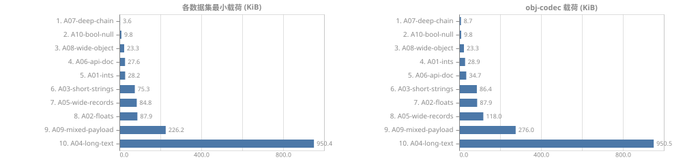

全部库的载荷体积（14 个库）

| 数据集 | json | v8 | cbor-x | msgpack | msgpackr | superjson | devalue | seroval | turbo-stream | flatted | ungap-structured-clone | bson | ion-js | obj-codec |
| --- | ---: | ---: | ---: | ---: | ---: | ---: | ---: | ---: | ---: | ---: | ---: | ---: | ---: | ---: |
| A01-ints | 46KB | 29KB | 28KB | 28KB | 28KB | 46KB | 65KB | 46KB | 46KB | 46KB | 81KB | 97KB | 29KB | 29KB |
| A02-floats | 185KB | 88KB | 88KB | 88KB | 88KB | 185KB | 233KB | 185KB | 185KB | 185KB | 272KB | 136KB | 88KB | 88KB |
| A03-short-strings | 154KB | 132KB | 120KB | 116KB | 75KB | 154KB | 158KB | 133KB | 154KB | 168KB | 157KB | 160KB | 87KB | 86KB |
| A04-long-text | 950KB | 950KB | 950KB | 950KB | 950KB | 950KB | 950KB | 950KB | 950KB | 950KB | 950KB | 950KB | 950KB | 950KB |
| A05-wide-records | 316KB | 278KB | 247KB | 246KB | 85KB | 316KB | 277KB | 277KB | 316KB | 312KB | 180KB | 324KB | 106KB | 118KB |
| A06-api-doc | 58KB | 53KB | 47KB | 45KB | 28KB | 59KB | 66KB | 52KB | 58KB | 71KB | 67KB | 63KB | 33KB | 35KB |
| A07-deep-chain | 20KB | 18KB | 16KB | 14KB | 3.6KB | 20KB | 29KB | 17KB | 20KB | 26KB | 30KB | 21KB | 7.6KB | 8.7KB |
| A08-wide-object | 33KB | 28KB | 25KB | 25KB | 25KB | 33KB | 31KB | 29KB | 33KB | 29KB | 57KB | 32KB | 29KB | 23KB |
| A09-mixed-payload | 576KB | 403KB | 359KB | 351KB | 226KB | 576KB | 687KB | 528KB | 576KB | 624KB | 731KB | 469KB | 256KB | 276KB |
| A10-bool-null | 52KB | 9.8KB | 9.8KB | 9.8KB | 9.8KB | 52KB | 20KB | 36KB | 52KB | 52KB | 20KB | 64KB | 9.8KB | 9.8KB |

gzip (level 9) 后体积：

| 数据集 | json | v8 | cbor-x | msgpack | msgpackr | superjson | devalue | seroval | turbo-stream | flatted | ungap-structured-clone | bson | ion-js | obj-codec |
| --- | ---: | ---: | ---: | ---: | ---: | ---: | ---: | ---: | ---: | ---: | ---: | ---: | ---: | ---: |
| A01-ints | 9.0KB | 8.7KB | 8.5KB | 8.4KB | 8.4KB | 9.0KB | 9.2KB | 9.0KB | 9.0KB | 9.0KB | 20KB | 29KB | 8.5KB | 8.6KB |
| A02-floats | 89KB | 60KB | 60KB | 60KB | 60KB | 89KB | 111KB | 89KB | 89KB | 89KB | 116KB | 80KB | 60KB | 60KB |
| A03-short-strings | 17KB | 18KB | 17KB | 17KB | 16KB | 17KB | 34KB | 17KB | 17KB | 27KB | 33KB | 25KB | 18KB | 17KB |
| A04-long-text | 115KB | 115KB | 115KB | 115KB | 115KB | 115KB | 115KB | 115KB | 115KB | 115KB | 115KB | 115KB | 115KB | 115KB |
| A05-wide-records | 49KB | 50KB | 48KB | 48KB | 31KB | 49KB | 49KB | 48KB | 49KB | 50KB | 48KB | 58KB | 44KB | 43KB |
| A06-api-doc | 7.9KB | 8.2KB | 7.9KB | 7.8KB | 7.3KB | 7.9KB | 16KB | 7.8KB | 7.9KB | 13KB | 16KB | 9.7KB | 8.6KB | 7.5KB |
| A07-deep-chain | 2.3KB | 1.8KB | 2.2KB | 2.0KB | 2.4KB | 2.3KB | 7.2KB | 2.2KB | 2.3KB | 4.7KB | 7.1KB | 3.8KB | 4.3KB | 1.8KB |
| A08-wide-object | 8.5KB | 7.0KB | 7.4KB | 7.4KB | 7.8KB | 8.5KB | 10KB | 8.2KB | 8.5KB | 8.3KB | 16KB | 7.8KB | 12KB | 6.8KB |
| A09-mixed-payload | 179KB | 132KB | 130KB | 130KB | 123KB | 179KB | 260KB | 177KB | 179KB | 191KB | 265KB | 143KB | 129KB | 118KB |
| A10-bool-null | 158B | 61B | 52B | 53B | 53B | 171B | 91B | 122B | 160B | 159B | 98B | 24KB | 59B | 76B |

### 内存（子进程，GC 后采样）

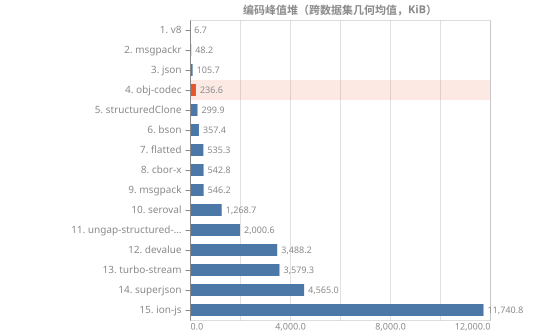

全部内存采样

| 数据集 | 库 | 编码峰值堆 | 解码峰值堆 | 结果常驻 | 进程 maxRSS |
| --- | --- | ---: | ---: | ---: | ---: |
| A01-ints | json | 50KB | 82KB | 104KB | 103MB |
| A01-ints | v8 | 4.9KB | 82KB | 60KB | 101MB |
| A01-ints | structuredClone | 86KB | 3.6KB | 60KB | 104MB |
| A01-ints | superjson | 4.0MB | 84KB | 116KB | 108MB |
| A01-ints | cbor-x | 396KB | 82KB | 61KB | 102MB |
| A01-ints | msgpackr | 18KB | 88KB | 56KB | 104MB |
| A01-ints | msgpack | 409KB | 96KB | 63KB | 101MB |
| A01-ints | devalue | 3.8MB | 303KB | 124KB | 102MB |
| A01-ints | seroval | 1.3MB | 130KB | 107KB | 103MB |
| A01-ints | turbo-stream | 3.3MB | 930KB | 152KB | 112MB |
| A01-ints | flatted | 297KB | 1.4MB | 107KB | 101MB |
| A01-ints | ungap-structured-clone | 2.4MB | 1.9MB | 746KB | 104MB |
| A01-ints | bson | 258KB | 250KB | 72KB | 103MB |
| A01-ints | ion-js | 15MB | 7.0MB | 26KB | 136MB |
| A01-ints | obj-codec | 169KB | 3.0MB | 46KB | 103MB |
| A02-floats | json | 190KB | 82KB | 243KB | 104MB |
| A02-floats | v8 | 4.9KB | 239KB | 215KB | 102MB |
| A02-floats | structuredClone | 240KB | 3.6KB | 217KB | 102MB |
| A02-floats | superjson | 4.7MB | 84KB | 254KB | 108MB |
| A02-floats | cbor-x | 614KB | 317KB | 61KB | 101MB |
| A02-floats | msgpackr | 233KB | 323KB | 59KB | 100MB |
| A02-floats | msgpack | 569KB | 330KB | 51KB | 103MB |
| A02-floats | devalue | 5.7MB | 826KB | 683KB | 108MB |
| A02-floats | seroval | 2.1MB | 346KB | 329KB | 103MB |
| A02-floats | turbo-stream | 3.6MB | 5.5MB | 306KB | 119MB |
| A02-floats | flatted | 587KB | 2.4MB | 245KB | 105MB |
| A02-floats | ungap-structured-clone | 5.0MB | 4.0MB | 330KB | 111MB |
| A02-floats | bson | 417KB | 432KB | 93KB | 104MB |
| A02-floats | ion-js | 12MB | 11MB | 29KB | 129MB |
| A02-floats | obj-codec | 191KB | 4.0MB | 65KB | 104MB |
| A03-short-strings | json | 158KB | 274KB | 392KB | 103MB |
| A03-short-strings | v8 | 4.9KB | 472KB | 246KB | 105MB |
| A03-short-strings | structuredClone | 473KB | 3.6KB | 247KB | 103MB |
| A03-short-strings | superjson | 5.2MB | 276KB | 413KB | 111MB |
| A03-short-strings | cbor-x | 726KB | 587KB | 361KB | 104MB |
| A03-short-strings | msgpackr | 214KB | 353KB | 295KB | 105MB |
| A03-short-strings | msgpack | 742KB | 1.7MB | 225KB | 106MB |
| A03-short-strings | devalue | 4.3MB | 1.2MB | 572KB | 109MB |
| A03-short-strings | seroval | 2.5MB | 502KB | 458KB | 107MB |
| A03-short-strings | turbo-stream | 4.5MB | 2.7MB | 972KB | 123MB |
| A03-short-strings | flatted | 1.4MB | 3.0MB | 640KB | 105MB |
| A03-short-strings | ungap-structured-clone | 5.3MB | 4.1MB | 351KB | 111MB |
| A03-short-strings | bson | 592KB | 2.8MB | 272KB | 107MB |
| A03-short-strings | ion-js | 27MB | 17MB | 625KB | 198MB |
| A03-short-strings | obj-codec | 2.5MB | 6.3MB | 191KB | 111MB |
| A04-long-text | json | 955KB | 954KB | 1.8MB | 116MB |
| A04-long-text | v8 | 4.9KB | 955KB | 931KB | 114MB |
| A04-long-text | structuredClone | 956KB | 3.6KB | 931KB | 113MB |
| A04-long-text | superjson | 965KB | 956KB | 1.8MB | 112MB |
| A04-long-text | cbor-x | 20KB | 998KB | 981KB | 112MB |
| A04-long-text | msgpackr | 11KB | 993KB | 975KB | 115MB |
| A04-long-text | msgpack | 17KB | 975KB | 947KB | 115MB |
| A04-long-text | devalue | 959KB | 1.9MB | 1.8MB | 114MB |
| A04-long-text | seroval | 20KB | 957KB | 930KB | 116MB |
| A04-long-text | turbo-stream | 1.9MB | 30MB | 31MB | 169MB |
| A04-long-text | flatted | 1.9MB | 1.9MB | 1.8MB | 112MB |
| A04-long-text | ungap-structured-clone | 958KB | 957KB | 1.8MB | 114MB |
| A04-long-text | bson | 33KB | 973KB | 960KB | 116MB |
| A04-long-text | ion-js | 66KB | 992KB | 967KB | 118MB |
| A04-long-text | obj-codec | 34KB | 992KB | 960KB | 116MB |
| A05-wide-records | json | 664KB | 191KB | 485KB | 108MB |
| A05-wide-records | v8 | 349KB | 540KB | 430KB | 109MB |
| A05-wide-records | structuredClone | 887KB | 3.6KB | 421KB | 112MB |
| A05-wide-records | superjson | 11MB | 193KB | 479KB | 118MB |
| A05-wide-records | cbor-x | 1.9MB | 2.2MB | 1.0MB | 113MB |
| A05-wide-records | msgpackr | 809KB | 543KB | 398KB | 109MB |
| A05-wide-records | msgpack | 1.3MB | 3.2MB | 1.0MB | 113MB |
| A05-wide-records | devalue | 5.8MB | 2.8MB | 1.1MB | 115MB |
| A05-wide-records | seroval | 4.8MB | 836KB | 796KB | 117MB |
| A05-wide-records | turbo-stream | 7.7MB | 5.7MB | 1.4MB | 126MB |
| A05-wide-records | flatted | 1.2MB | 3.8MB | 621KB | 112MB |
| A05-wide-records | ungap-structured-clone | 5.6MB | 6.6MB | 1007KB | 118MB |
| A05-wide-records | bson | 631KB | 7.2MB | 1.1MB | 119MB |
| A05-wide-records | ion-js | 57MB | 28MB | 1.0MB | 299MB |
| A05-wide-records | obj-codec | 2.2MB | 4.0MB | 848KB | 114MB |
| A06-api-doc | json | 63KB | 123KB | 159KB | 104MB |
| A06-api-doc | v8 | 4.9KB | 266KB | 136KB | 104MB |
| A06-api-doc | structuredClone | 288KB | 3.6KB | 145KB | 103MB |
| A06-api-doc | superjson | 5.9MB | 125KB | 161KB | 109MB |
| A06-api-doc | cbor-x | 273KB | 262KB | 144KB | 103MB |
| A06-api-doc | msgpackr | 232KB | 196KB | 116KB | 102MB |
| A06-api-doc | msgpack | 398KB | 1.2MB | 78KB | 103MB |
| A06-api-doc | devalue | 1.8MB | 610KB | 178KB | 105MB |
| A06-api-doc | seroval | 1.1MB | 244KB | 216KB | 103MB |
| A06-api-doc | turbo-stream | 2.0MB | 1.3MB | 616KB | 118MB |
| A06-api-doc | flatted | 847KB | 1.5MB | 169KB | 105MB |
| A06-api-doc | ungap-structured-clone | 2.6MB | 1.9MB | 236KB | 106MB |
| A06-api-doc | bson | 417KB | 1.3MB | 231KB | 105MB |
| A06-api-doc | ion-js | 15MB | 7.7MB | 343KB | 149MB |
| A06-api-doc | obj-codec | 1.4MB | 2.9MB | 150KB | 103MB |
| A07-deep-chain | json | 25KB | 43KB | 39KB | 102MB |
| A07-deep-chain | v8 | 4.9KB | 155KB | 36KB | 102MB |
| A07-deep-chain | structuredClone | 161KB | 3.6KB | 37KB | 103MB |
| A07-deep-chain | superjson | 23MB | 45KB | 40KB | 137MB |
| A07-deep-chain | cbor-x | 182KB | 132KB | 43KB | 102MB |
| A07-deep-chain | msgpackr | 92KB | 48KB | 21KB | 104MB |
| A07-deep-chain | msgpack | 249KB | 373KB | 5.1KB | 103MB |
| A07-deep-chain | devalue | 1.1MB | 385KB | 66KB | 103MB |
| A07-deep-chain | seroval | 767KB | 132KB | 111KB | 102MB |
| A07-deep-chain | turbo-stream | 1.1MB | 413KB | 91KB | 110MB |
| A07-deep-chain | flatted | 289KB | 748KB | 131KB | 103MB |
| A07-deep-chain | ungap-structured-clone | 1.7MB | 1.2MB | 450KB | 103MB |
| A07-deep-chain | bson | 255KB | 655KB | 55KB | 102MB |
| A07-deep-chain | ion-js | 5.1MB | 4.4MB | -110288B | 130MB |
| A07-deep-chain | obj-codec | 731KB | 1.9MB | 32KB | 106MB |
| A08-wide-object | json | 69KB | 100KB | 110KB | 102MB |
| A08-wide-object | v8 | 36KB | 1.8MB | 101KB | 102MB |
| A08-wide-object | structuredClone | 1.8MB | 3.6KB | 100KB | 102MB |
| A08-wide-object | superjson | 2.6MB | 102KB | 101KB | 105MB |
| A08-wide-object | cbor-x | 207KB | 380KB | 95KB | 103MB |
| A08-wide-object | msgpackr | 84KB | 370KB | 106KB | 103MB |
| A08-wide-object | msgpack | 119KB | 2.7MB | 89KB | 105MB |
| A08-wide-object | devalue | 1.2MB | 488KB | 109KB | 104MB |
| A08-wide-object | seroval | 498KB | 169KB | 137KB | 103MB |
| A08-wide-object | turbo-stream | 944KB | 860KB | 156KB | 111MB |
| A08-wide-object | flatted | 100KB | 481KB | 109KB | 103MB |
| A08-wide-object | ungap-structured-clone | 1.9MB | 1.5MB | 133KB | 103MB |
| A08-wide-object | bson | 39KB | 850KB | 105KB | 102MB |
| A08-wide-object | ion-js | 5.7MB | 5.3MB | -25800B | 131MB |
| A08-wide-object | obj-codec | 712KB | 2.1MB | 64KB | 104MB |
| A09-mixed-payload | json | 581KB | 734KB | 1.3MB | 115MB |
| A09-mixed-payload | v8 | 4.9KB | 1.6MB | 1.1MB | 115MB |
| A09-mixed-payload | structuredClone | 1.6MB | 3.6KB | 1.0MB | 113MB |
| A09-mixed-payload | superjson | 5.3MB | 764KB | 1.3MB | 138MB |
| A09-mixed-payload | cbor-x | 2.4MB | 2.2MB | 1.3MB | 116MB |
| A09-mixed-payload | msgpackr | 840KB | 1.2MB | 1.1MB | 115MB |
| A09-mixed-payload | msgpack | 2.8MB | 2.8MB | 989KB | 116MB |
| A09-mixed-payload | devalue | 15MB | 4.4MB | 2.7MB | 132MB |
| A09-mixed-payload | seroval | 8.8MB | 1.9MB | 1.9MB | 123MB |
| A09-mixed-payload | turbo-stream | 13MB | 13MB | 2.7MB | 135MB |
| A09-mixed-payload | flatted | 3.8MB | 10MB | 2.0MB | 123MB |
| A09-mixed-payload | ungap-structured-clone | 17MB | 16MB | 2.0MB | 140MB |
| A09-mixed-payload | bson | 1.8MB | 8.0MB | 1.4MB | 119MB |
| A09-mixed-payload | ion-js | 79MB | 50MB | 1.9MB | 371MB |
| A09-mixed-payload | obj-codec | 5.4MB | 12MB | 1.2MB | 120MB |
| A10-bool-null | json | 57KB | 82KB | 111KB | 102MB |
| A10-bool-null | v8 | 4.9KB | 82KB | 59KB | 102MB |
| A10-bool-null | structuredClone | 87KB | 3.6KB | 60KB | 103MB |
| A10-bool-null | superjson | 3.9MB | 84KB | 123KB | 108MB |
| A10-bool-null | cbor-x | 395KB | 103KB | 69KB | 102MB |
| A10-bool-null | msgpackr | 7.8KB | 104KB | 60KB | 101MB |
| A10-bool-null | msgpack | 405KB | 94KB | 59KB | 102MB |
| A10-bool-null | devalue | 2.5MB | 183KB | 81KB | 103MB |
| A10-bool-null | seroval | 663KB | 120KB | 101KB | 103MB |
| A10-bool-null | turbo-stream | 3.0MB | 278KB | 143KB | 111MB |
| A10-bool-null | flatted | 302KB | 1.1MB | 113KB | 103MB |
| A10-bool-null | ungap-structured-clone | 648KB | 723KB | 79KB | 101MB |
| A10-bool-null | bson | 242KB | 240KB | 43KB | 105MB |
| A10-bool-null | ion-js | 7.4MB | 6.2MB | 28KB | 113MB |
| A10-bool-null | obj-codec | 35KB | 2.9MB | 55KB | 104MB |

## 套件 S1

### 汇总（跨数据集几何均值）

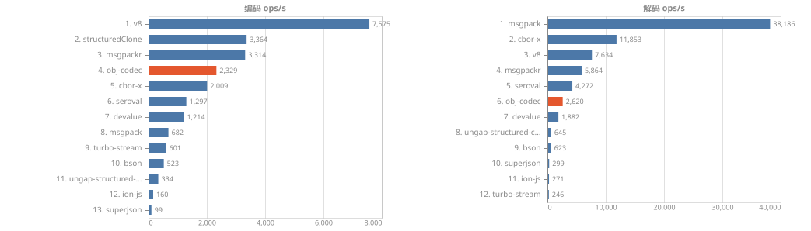

汇总数值

| 库 | 编码 ops/s | 解码 ops/s | 参与数据集 | 失败 |
| --- | ---: | ---: | ---: | ---: |
| v8 | 7,411 | 7,655 | 7 | 0 |
| structuredClone | 3,412 | - | 7 | 0 |
| msgpackr | 3,316 | 5,835 | 5 | 0 |
| obj-codec | 2,075 | 1,632 | 7 | 0 |
| cbor-x | 1,989 | 11,604 | 4 | 1 |
| seroval | 1,321 | 4,285 | 6 | 1 |
| devalue | 1,216 | 1,897 | 7 | 0 |
| msgpack | 694 | 37,475 | 2 | 1 |
| turbo-stream | 597 | 245 | 7 | 0 |
| bson | 513 | 609 | 1 | 0 |
| ungap-structured-clone | 335 | 649 | 4 | 0 |
| ion-js | 157 | 248 | 2 | 0 |
| superjson | 98 | 299 | 5 | 0 |

### 分数据集吞吐

分数据集明细（7 个数据集，各含图表与完整数值）

**B01-bigint — BigInt 数组（含 >64bit）3e3**

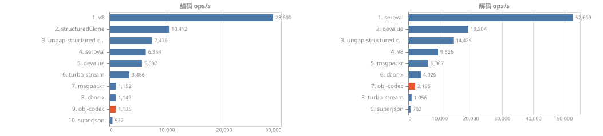

| 库 | 编码 ops/s | 解码 ops/s | 编码 MB/s | 解码 MB/s | enc p75 (ms) | dec p75 (ms) | 样本 | enc RME |
| --- | ---: | ---: | ---: | ---: | ---: | ---: | ---: | ---: |
| v8 | 28,864 | 9,796 | 1054.13 | 357.76 | 0.037 | 0.085 | 7216 | 2.4% |
| structuredClone | 10,477 | - | - | - | 0.095 | - | 2620 | 0.4% |
| ungap-structured-clone | 7,347 | 14,368 | 74.46 | 145.62 | 0.133 | 0.068 | 1837 | 0.8% |
| seroval | 6,414 | 53,599 | 338.96 | 2832.47 | 0.149 | 0.019 | 1604 | 1.1% |
| devalue | 5,573 | 19,169 | 59.04 | 203.06 | 0.170 | 0.052 | 1394 | 2.0% |
| turbo-stream | 3,493 | 962 | 184.57 | 50.84 | 0.278 | 1.033 | 874 | 1.3% |
| msgpackr | 1,148 | 6,406 | 39.95 | 222.92 | 1.245 | 0.150 | 287 | 5.7% |
| cbor-x | 1,098 | 3,860 | 34.19 | 120.17 | 1.359 | 0.254 | 276 | 5.3% |
| obj-codec | 1,031 | 1,676 | 26.56 | 43.20 | 0.966 | 0.610 | 258 | 1.8% |
| superjson | 541 | 699 | 69.69 | 90.08 | 1.912 | 1.371 | 136 | 2.5% |

**B02-date — Date 密集 3e3**

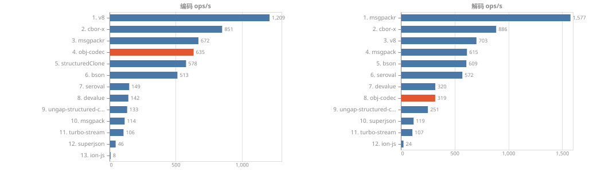

| 库 | 编码 ops/s | 解码 ops/s | 编码 MB/s | 解码 MB/s | enc p75 (ms) | dec p75 (ms) | 样本 | enc RME |
| --- | ---: | ---: | ---: | ---: | ---: | ---: | ---: | ---: |
| v8 | 1,209 | 703 | 265.03 | 154.06 | 0.732 | 1.350 | 307 | 17.2% |
| cbor-x | 851 | 886 | 171.17 | 178.32 | 1.192 | 1.103 | 213 | 0.9% |
| msgpackr | 672 | 1,577 | 66.64 | 156.52 | 1.498 | 0.601 | 168 | 3.3% |
| obj-codec | 635 | 319 | 83.94 | 42.17 | 1.556 | 3.157 | 159 | 5.1% |
| structuredClone | 578 | - | - | - | 1.694 | - | 145 | 1.6% |
| bson | 513 | 609 | 124.20 | 147.50 | 1.937 | 1.698 | 129 | 1.8% |
| seroval | 149 | 572 | 68.25 | 262.60 | 7.220 | 1.580 | 38 | 4.0% |
| devalue | 142 | 320 | 74.02 | 166.61 | 7.292 | 3.083 | 36 | 6.2% |
| ungap-structured-clone | 133 | 251 | 55.37 | 104.58 | 8.259 | 3.830 | 34 | 4.6% |
| msgpack | 114 | 615 | 22.28 | 119.98 | 11.932 | 1.620 | 29 | 13.2% |
| turbo-stream | 106 | 107 | 42.52 | 43.09 | 9.579 | 9.755 | 27 | 3.4% |
| superjson | 46 | 119 | 28.24 | 72.52 | 22.579 | 8.124 | 12 | 5.2% |
| ion-js | 8 | 24 | 1.10 | 3.33 | 132.866 | 45.027 | 2 | 75.6% |

**B03-collections — Map/Set 密集 2e3 项**

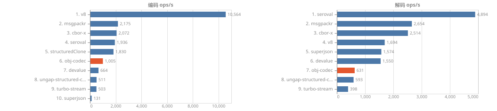

| 库 | 编码 ops/s | 解码 ops/s | 编码 MB/s | 解码 MB/s | enc p75 (ms) | dec p75 (ms) | 样本 | enc RME |
| --- | ---: | ---: | ---: | ---: | ---: | ---: | ---: | ---: |
| v8 | 10,564 | 1,694 | 770.43 | 123.54 | 0.094 | 0.550 | 2642 | 0.6% |
| msgpackr | 2,175 | 2,654 | 148.78 | 181.53 | 0.460 | 0.373 | 544 | 0.8% |
| cbor-x | 2,072 | 2,514 | 141.81 | 172.09 | 0.481 | 0.391 | 518 | 0.8% |
| seroval | 1,936 | 4,894 | 185.22 | 468.28 | 0.459 | 0.201 | 484 | 3.3% |
| structuredClone | 1,830 | - | - | - | 0.538 | - | 458 | 0.9% |
| obj-codec | 1,005 | 631 | 71.64 | 44.98 | 0.968 | 1.544 | 252 | 3.0% |
| devalue | 664 | 1,550 | 89.09 | 208.07 | 1.380 | 0.634 | 166 | 4.2% |
| ungap-structured-clone | 511 | 593 | 92.82 | 107.54 | 2.087 | 1.621 | 128 | 4.5% |
| turbo-stream | 503 | 398 | 48.07 | 38.06 | 2.106 | 2.555 | 126 | 4.3% |
| superjson | 131 | 1,574 | 12.52 | 150.71 | 9.267 | 0.627 | 33 | 8.0% |

**B04-binary — 二进制载荷 1MB Uint8Array**

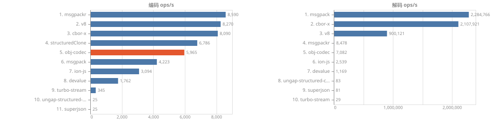

| 库 | 编码 ops/s | 解码 ops/s | 编码 MB/s | 解码 MB/s | enc p75 (ms) | dec p75 (ms) | 样本 | enc RME |
| --- | ---: | ---: | ---: | ---: | ---: | ---: | ---: | ---: |
| msgpackr | 8,590 | 8,478 | 9007.74 | 8889.62 | 0.084 | 0.109 | 2148 | 4.4% |
| v8 | 8,270 | 900,121 | 8671.72 | 943870.59 | 0.083 | 0.001 | 2068 | 4.7% |
| cbor-x | 8,090 | 2,107,921 | 8482.83 | 2210367.57 | 0.081 | 0.000 | 2023 | 5.1% |
| structuredClone | 6,786 | - | - | - | 0.115 | - | 1697 | 4.0% |
| obj-codec | 5,965 | 7,082 | 6254.90 | 7426.00 | 0.146 | 0.116 | 1494 | 5.1% |
| msgpack | 4,223 | 2,284,766 | 4428.10 | 2395799.13 | 0.256 | 0.000 | 1056 | 4.3% |
| ion-js | 3,094 | 2,539 | 3244.25 | 2662.32 | 0.268 | 0.301 | 774 | 5.6% |
| devalue | 1,762 | 1,169 | 2463.06 | 1634.28 | 0.512 | 0.801 | 441 | 6.0% |
| turbo-stream | 345 | 29 | 482.90 | 40.83 | 2.838 | 33.319 | 87 | 3.2% |
| ungap-structured-clone | 25 | 83 | 94.25 | 309.48 | 42.619 | 12.328 | 7 | 7.1% |
| superjson | 25 | 81 | 93.51 | 302.08 | 42.328 | 12.482 | 7 | 5.6% |

**B05-typed-arrays — TypedArray / ArrayBuffer / DataView 混合**

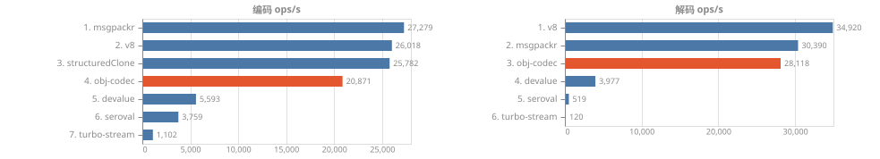

| 库 | 编码 ops/s | 解码 ops/s | 编码 MB/s | 解码 MB/s | enc p75 (ms) | dec p75 (ms) | 样本 | enc RME |
| --- | ---: | ---: | ---: | ---: | ---: | ---: | ---: | ---: |
| structuredClone | 28,268 | - | - | - | 0.026 | - | 7067 | 3.4% |
| msgpackr | 27,812 | 29,760 | 7846.45 | 8396.09 | 0.024 | 0.026 | 6953 | 4.6% |
| v8 | 25,334 | 35,831 | 7147.52 | 10108.95 | 0.031 | 0.021 | 6334 | 4.0% |
| obj-codec | 21,139 | 27,378 | 5964.21 | 7724.64 | 0.037 | 0.030 | 5285 | 4.0% |
| devalue | 5,575 | 4,242 | 2090.50 | 1590.73 | 0.165 | 0.214 | 1394 | 2.9% |
| seroval | 3,776 | 502 | 1416.38 | 188.14 | 0.235 | 2.025 | 944 | 3.5% |
| turbo-stream | 1,109 | 128 | 417.05 | 48.14 | 0.926 | 8.751 | 278 | 1.2% |

**B06-edge-values — 边界值 undefined / NaN / ±Inf / -0**

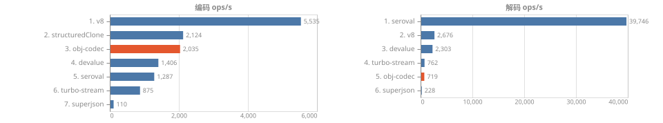

| 库 | 编码 ops/s | 解码 ops/s | 编码 MB/s | 解码 MB/s | enc p75 (ms) | dec p75 (ms) | 样本 | enc RME |
| --- | ---: | ---: | ---: | ---: | ---: | ---: | ---: | ---: |
| v8 | 5,535 | 2,676 | 536.82 | 259.56 | 0.185 | 0.361 | 1384 | 4.3% |
| structuredClone | 2,124 | - | - | - | 0.460 | - | 531 | 1.0% |
| obj-codec | 2,035 | 719 | 113.89 | 40.25 | 0.482 | 1.437 | 509 | 3.1% |
| devalue | 1,406 | 2,303 | 129.14 | 211.49 | 0.656 | 0.422 | 352 | 3.7% |
| seroval | 1,287 | 39,746 | 102.84 | 3176.88 | 0.723 | 0.024 | 322 | 2.6% |
| turbo-stream | 875 | 762 | 72.55 | 63.16 | 1.148 | 1.291 | 219 | 2.1% |
| superjson | 110 | 228 | 30.09 | 62.47 | 9.332 | 4.296 | 28 | 5.5% |

**B07-everything — 全类型混合（扩展版 A06）**

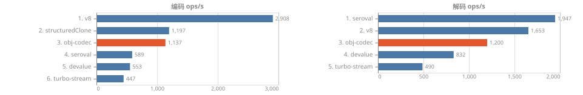

| 库 | 编码 ops/s | 解码 ops/s | 编码 MB/s | 解码 MB/s | enc p75 (ms) | dec p75 (ms) | 样本 | enc RME |
| --- | ---: | ---: | ---: | ---: | ---: | ---: | ---: | ---: |
| v8 | 2,874 | 1,531 | 205.88 | 109.66 | 0.345 | 0.621 | 719 | 1.0% |
| structuredClone | 1,193 | - | - | - | 0.762 | - | 299 | 3.0% |
| obj-codec | 981 | 656 | 45.09 | 30.14 | 0.999 | 1.624 | 246 | 3.4% |
| seroval | 593 | 2,069 | 67.87 | 236.81 | 1.976 | 0.371 | 149 | 3.3% |
| devalue | 540 | 813 | 79.01 | 118.91 | 2.021 | 1.199 | 136 | 3.5% |
| turbo-stream | 435 | 449 | 44.37 | 45.79 | 2.356 | 2.208 | 109 | 3.6% |

### 载荷体积

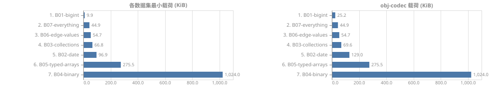

全部库的载荷体积（12 个库）

| 数据集 | v8 | cbor-x | msgpack | msgpackr | superjson | devalue | seroval | turbo-stream | ungap-structured-clone | bson | ion-js | obj-codec |
| --- | ---: | ---: | ---: | ---: | ---: | ---: | ---: | ---: | ---: | ---: | ---: | ---: |
| B01-bigint | 36KB | 30KB | - | 34KB | 126KB | 10KB | 52KB | 52KB | 9.9KB | - | - | 25KB |
| B02-date | 214KB | 196KB | 191KB | 97KB | 598KB | 509KB | 448KB | 393KB | 406KB | 236KB | 134KB | 129KB |
| B03-collections | 71KB | 67KB | - | 67KB | 93KB | 131KB | 93KB | 93KB | 177KB | - | - | 70KB |
| B04-binary | 1.0MB | 1.0MB | 1.0MB | 1.0MB | 3.6MB | 1.3MB | - | 1.3MB | 3.6MB | - | 1.0MB | 1.0MB |
| B05-typed-arrays | 276KB | - | - | 276KB | - | 366KB | 366KB | 367KB | - | - | - | 276KB |
| B06-edge-values | 95KB | - | - | - | 267KB | 90KB | 78KB | 81KB | - | - | - | 55KB |
| B07-everything | 70KB | - | - | - | - | 143KB | 112KB | 100KB | - | - | - | 45KB |

gzip (level 9) 后体积：

| 数据集 | v8 | cbor-x | msgpack | msgpackr | superjson | devalue | seroval | turbo-stream | ungap-structured-clone | bson | ion-js | obj-codec |
| --- | ---: | ---: | ---: | ---: | ---: | ---: | ---: | ---: | ---: | ---: | ---: | ---: |
| B01-bigint | 3.3KB | 3.2KB | - | 3.2KB | 19KB | 2.8KB | 3.3KB | 3.3KB | 2.8KB | - | - | 3.2KB |
| B02-date | 35KB | 41KB | 47KB | 42KB | 71KB | 83KB | 49KB | 49KB | 80KB | 44KB | 43KB | 34KB |
| B03-collections | 27KB | 27KB | - | 27KB | 30KB | 52KB | 30KB | 30KB | 55KB | - | - | 27KB |
| B04-binary | 1.0MB | 1.0MB | 1.0MB | 1.0MB | 1.3MB | 1.0MB | - | 1.0MB | 1.3MB | - | 1.0MB | 1.0MB |
| B05-typed-arrays | 222KB | - | - | 222KB | - | 232KB | 233KB | 232KB | - | - | - | 222KB |
| B06-edge-values | 2.5KB | - | - | - | 20KB | 7.5KB | 2.8KB | 2.9KB | - | - | - | 2.4KB |
| B07-everything | 17KB | - | - | - | - | 34KB | 20KB | 19KB | - | - | - | 15KB |

### 内存（子进程，GC 后采样）

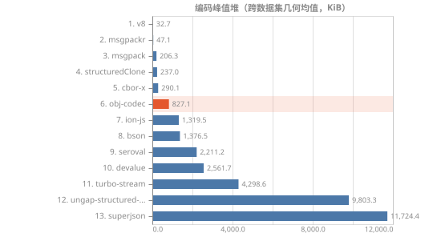

全部内存采样

| 数据集 | 库 | 编码峰值堆 | 解码峰值堆 | 结果常驻 | 进程 maxRSS |
| --- | --- | ---: | ---: | ---: | ---: |
| B01-bigint | v8 | 4.9KB | 104KB | 80KB | 102MB |
| B01-bigint | structuredClone | 111KB | 3.6KB | 83KB | 102MB |
| B01-bigint | superjson | 4.6MB | 4.5MB | 117KB | 110MB |
| B01-bigint | cbor-x | 2.0MB | 1.2MB | 92KB | 103MB |
| B01-bigint | msgpackr | 823KB | 999KB | 79KB | 103MB |
| B01-bigint | devalue | 788KB | 72KB | 16KB | 102MB |
| B01-bigint | seroval | 615KB | 242KB | 214KB | 103MB |
| B01-bigint | turbo-stream | 1.2MB | 1.6MB | 187KB | 109MB |
| B01-bigint | ungap-structured-clone | 270KB | 300KB | 29KB | 101MB |
| B01-bigint | obj-codec | 1.5MB | 3.1MB | 86KB | 104MB |
| B02-date | v8 | 4.9KB | 1.6MB | 1.1MB | 106MB |
| B02-date | structuredClone | 1.6MB | 3.6KB | 1.1MB | 105MB |
| B02-date | superjson | 13MB | 13MB | 1.6MB | 132MB |
| B02-date | cbor-x | 1.1MB | 1.8MB | 1.1MB | 106MB |
| B02-date | msgpackr | 2.9MB | 3.0MB | 1.1MB | 109MB |
| B02-date | msgpack | 4.8MB | 4.1MB | 1.1MB | 113MB |
| B02-date | devalue | 8.3MB | 3.8MB | 2.7MB | 120MB |
| B02-date | seroval | 5.4MB | 2.4MB | 2.4MB | 117MB |
| B02-date | turbo-stream | 8.1MB | 3.0MB | 1.5MB | 127MB |
| B02-date | ungap-structured-clone | 8.9MB | 7.9MB | 1.4MB | 116MB |
| B02-date | bson | 1.3MB | 5.1MB | 1.1MB | 113MB |
| B02-date | ion-js | 27MB | 41MB | 976KB | 238MB |
| B02-date | obj-codec | 3.4MB | 3.5MB | 1013KB | 116MB |
| B03-collections | v8 | 83KB | 477KB | 299KB | 102MB |
| B03-collections | structuredClone | 585KB | 3.6KB | 301KB | 102MB |
| B03-collections | superjson | 6.9MB | 691KB | 285KB | 116MB |
| B03-collections | cbor-x | 1.3MB | 596KB | 311KB | 104MB |
| B03-collections | msgpackr | 966KB | 596KB | 314KB | 104MB |
| B03-collections | devalue | 4.7MB | 813KB | 552KB | 107MB |
| B03-collections | seroval | 2.8MB | 833KB | 504KB | 105MB |
| B03-collections | turbo-stream | 5.8MB | 3.6MB | 419KB | 118MB |
| B03-collections | ungap-structured-clone | 6.5MB | 4.3MB | 1.8MB | 111MB |
| B03-collections | obj-codec | 2.7MB | 4.6MB | 312KB | 109MB |
| B04-binary | v8 | 5.1KB | 4.5KB | -19680B | 114MB |
| B04-binary | structuredClone | 5.5KB | 3.6KB | -19968B | 115MB |
| B04-binary | superjson | 29MB | 16MB | 3.6MB | 188MB |
| B04-binary | cbor-x | 11KB | 15KB | 35KB | 116MB |
| B04-binary | msgpackr | 13KB | 43KB | 28KB | 118MB |
| B04-binary | msgpack | 8.9KB | 14KB | -9320B | 114MB |
| B04-binary | devalue | 1.4MB | 2.7MB | 1.3MB | 122MB |
| B04-binary | turbo-stream | 12MB | 44MB | 1.4MB | 197MB |
| B04-binary | ungap-structured-clone | 29MB | 16MB | 3.6MB | 187MB |
| B04-binary | ion-js | 66KB | 45KB | 29KB | 119MB |
| B04-binary | obj-codec | 24KB | 47KB | 10KB | 116MB |
| B05-typed-arrays | v8 | 7.3KB | 6.6KB | -17064B | 106MB |
| B05-typed-arrays | structuredClone | 8.5KB | 3.6KB | -9776B | 103MB |
| B05-typed-arrays | msgpackr | -291216B | 9.6KB | -312176B | 102MB |
| B05-typed-arrays | devalue | 750KB | 742KB | 351KB | 105MB |
| B05-typed-arrays | seroval | 1.1MB | 1.4MB | 1.1MB | 108MB |
| B05-typed-arrays | turbo-stream | 3.5MB | 12MB | 425KB | 124MB |
| B05-typed-arrays | obj-codec | 41KB | 45KB | 13KB | 103MB |
| B06-edge-values | v8 | 4.9KB | 304KB | 154KB | 102MB |
| B06-edge-values | structuredClone | 305KB | 3.6KB | 147KB | 103MB |
| B06-edge-values | superjson | 9.1MB | 7.5MB | 389KB | 113MB |
| B06-edge-values | devalue | 2.4MB | 1014KB | 435KB | 105MB |
| B06-edge-values | seroval | 1.5MB | 483KB | 466KB | 104MB |
| B06-edge-values | turbo-stream | 3.4MB | 1.1MB | 269KB | 117MB |
| B06-edge-values | obj-codec | 1.1MB | 5.0MB | 153KB | 107MB |
| B07-everything | v8 | 139KB | 521KB | 400KB | 102MB |
| B07-everything | structuredClone | 616KB | 3.6KB | 424KB | 105MB |
| B07-everything | devalue | 3.6MB | 1.4MB | 541KB | 109MB |
| B07-everything | seroval | 3.0MB | 1.1MB | 972KB | 112MB |
| B07-everything | turbo-stream | 4.1MB | 2.8MB | 619KB | 121MB |
| B07-everything | obj-codec | 2.1MB | 5.2MB | 386KB | 110MB |

### 失败与不保真

| 数据集 | 库 | 状态 | 说明 |
| --- | --- | --- | --- |
| B01-bigint | msgpack | fidelity-fail | [7]: bigint 2 != bigint 18446744073709551618 |
| B04-binary | seroval | error | Error: Seroval Error (step: 1) |
| B06-edge-values | cbor-x | fidelity-fail | $.rows[0].minusZero: -0 != 0 |

## 套件 S2

### 汇总（跨数据集几何均值）

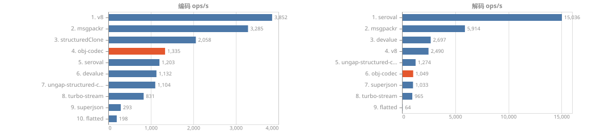

汇总数值

| 库 | 编码 ops/s | 解码 ops/s | 参与数据集 | 失败 |
| --- | ---: | ---: | ---: | ---: |
| v8 | 3,852 | 2,490 | 4 | 0 |
| msgpackr | 3,285 | 5,914 | 4 | 0 |
| structuredClone | 2,058 | - | 4 | 0 |
| obj-codec | 1,335 | 1,049 | 4 | 0 |
| seroval | 1,203 | 15,036 | 4 | 0 |
| devalue | 1,132 | 2,697 | 4 | 0 |
| ungap-structured-clone | 1,104 | 1,274 | 4 | 0 |
| turbo-stream | 831 | 965 | 4 | 0 |
| superjson | 293 | 1,033 | 4 | 0 |
| flatted | 198 | 64 | 3 | 1 |

### 分数据集吞吐

分数据集明细（4 个数据集，各含图表与完整数值）

**C01-cycle-simple — 简单自引用（对象/数组/Map/Set 环）**

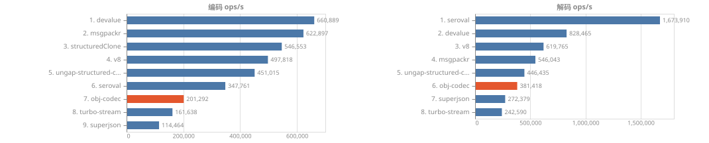

| 库 | 编码 ops/s | 解码 ops/s | 编码 MB/s | 解码 MB/s | enc p75 (ms) | dec p75 (ms) | 样本 | enc RME |
| --- | ---: | ---: | ---: | ---: | ---: | ---: | ---: | ---: |
| devalue | 656,972 | 823,486 | 70.95 | 88.94 | 0.001 | 0.001 | 164244 | 0.7% |
| msgpackr | 604,641 | 542,442 | 64.09 | 57.50 | 0.002 | 0.002 | 151161 | 0.4% |
| structuredClone | 543,506 | - | - | - | 0.002 | - | 135877 | 0.3% |
| ungap-structured-clone | 452,831 | 440,839 | 81.96 | 79.79 | 0.002 | 0.002 | 113208 | 0.5% |
| v8 | 441,611 | 590,658 | 35.77 | 47.84 | 0.001 | 0.001 | 110403 | 17.6% |
| seroval | 345,560 | 1,698,506 | 45.61 | 224.20 | 0.003 | 0.001 | 86423 | 1.2% |
| obj-codec | 212,841 | 292,598 | 18.52 | 25.46 | 0.004 | 0.003 | 53211 | 0.7% |
| turbo-stream | 162,221 | 233,015 | 14.44 | 20.74 | 0.006 | 0.004 | 40556 | 0.7% |
| superjson | 112,731 | 266,516 | 28.63 | 67.70 | 0.008 | 0.004 | 28183 | 0.6% |

**C02-dag-fanin — 高扇入 DAG（同一节点被 1e4 处引用）**

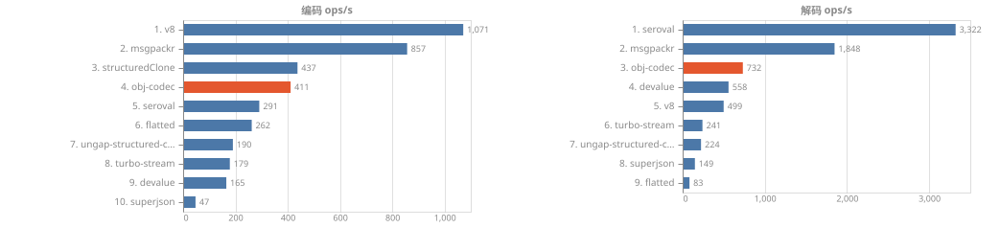

| 库 | 编码 ops/s | 解码 ops/s | 编码 MB/s | 解码 MB/s | enc p75 (ms) | dec p75 (ms) | 样本 | enc RME |
| --- | ---: | ---: | ---: | ---: | ---: | ---: | ---: | ---: |
| v8 | 1,074 | 502 | 173.88 | 81.31 | 0.894 | 1.633 | 269 | 8.6% |
| msgpackr | 871 | 1,928 | 86.92 | 192.31 | 1.102 | 0.503 | 218 | 1.8% |
| structuredClone | 436 | - | - | - | 2.369 | - | 109 | 1.4% |
| obj-codec | 327 | 222 | 42.55 | 28.88 | 3.263 | 4.825 | 82 | 5.7% |
| seroval | 310 | 3,342 | 46.22 | 497.89 | 3.521 | 0.260 | 78 | 4.3% |
| flatted | 264 | 83 | 73.29 | 23.13 | 4.006 | 12.594 | 66 | 1.7% |
| ungap-structured-clone | 190 | 224 | 71.87 | 84.54 | 5.173 | 4.869 | 48 | 6.4% |
| turbo-stream | 176 | 258 | 34.95 | 51.27 | 5.637 | 3.801 | 44 | 3.6% |
| devalue | 170 | 517 | 50.70 | 154.06 | 6.490 | 1.978 | 43 | 7.6% |
| superjson | 47 | 143 | 49.47 | 149.49 | 22.384 | 6.764 | 12 | 7.0% |

**C03-graph-entities — ORM 风格实体图（2e3 父 × 5 子，双向引用）**

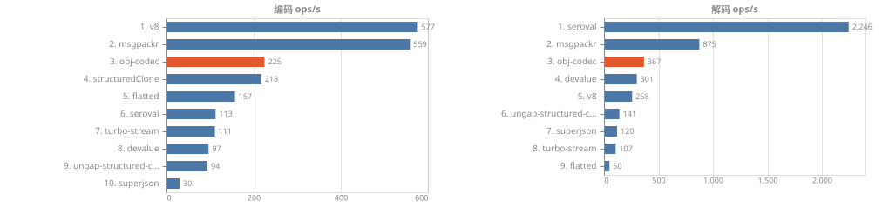

| 库 | 编码 ops/s | 解码 ops/s | 编码 MB/s | 解码 MB/s | enc p75 (ms) | dec p75 (ms) | 样本 | enc RME |
| --- | ---: | ---: | ---: | ---: | ---: | ---: | ---: | ---: |
| v8 | 579 | 279 | 231.79 | 111.79 | 1.728 | 3.108 | 145 | 0.3% |
| msgpackr | 545 | 904 | 92.23 | 153.07 | 1.815 | 1.102 | 137 | 1.5% |
| structuredClone | 223 | - | - | - | 4.614 | - | 56 | 1.4% |
| obj-codec | 181 | 108 | 46.20 | 27.48 | 5.741 | 10.391 | 46 | 6.2% |
| flatted | 157 | 50 | 94.92 | 30.35 | 6.658 | 20.516 | 40 | 1.9% |
| turbo-stream | 109 | 108 | 52.55 | 52.11 | 9.310 | 9.388 | 28 | 6.3% |
| seroval | 105 | 2,152 | 50.98 | 1047.14 | 9.771 | 0.395 | 27 | 7.1% |
| devalue | 100 | 283 | 63.16 | 179.52 | 10.059 | 3.678 | 25 | 10.5% |
| ungap-structured-clone | 97 | 141 | 61.90 | 90.17 | 11.511 | 6.425 | 25 | 10.7% |
| superjson | 31 | 122 | 25.66 | 101.45 | 34.930 | 8.227 | 8 | 9.2% |

**C04-refs-mixed — 环 + 共享 + 深嵌套混合**

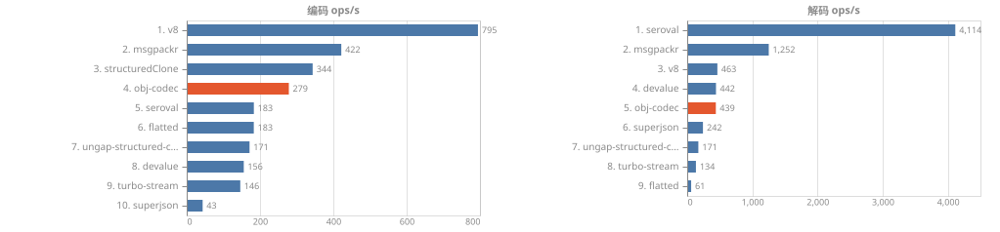

| 库 | 编码 ops/s | 解码 ops/s | 编码 MB/s | 解码 MB/s | enc p75 (ms) | dec p75 (ms) | 样本 | enc RME |
| --- | ---: | ---: | ---: | ---: | ---: | ---: | ---: | ---: |
| v8 | 801 | 463 | 262.76 | 152.06 | 1.133 | 2.107 | 208 | 13.6% |
| msgpackr | 406 | 1,295 | 69.24 | 220.68 | 2.461 | 0.720 | 102 | 1.9% |
| structuredClone | 341 | - | - | - | 3.074 | - | 86 | 1.5% |
| obj-codec | 251 | 173 | 45.55 | 31.33 | 4.046 | 6.090 | 63 | 5.3% |
| flatted | 188 | 63 | 88.68 | 29.60 | 5.582 | 16.892 | 47 | 2.0% |
| seroval | 186 | 4,185 | 58.02 | 1303.94 | 6.300 | 0.215 | 47 | 6.7% |
| ungap-structured-clone | 178 | 190 | 76.55 | 81.45 | 5.651 | 5.549 | 45 | 6.3% |
| turbo-stream | 154 | 134 | 55.03 | 47.95 | 6.277 | 7.560 | 39 | 4.9% |
| devalue | 147 | 439 | 60.66 | 180.68 | 7.513 | 2.172 | 38 | 6.6% |
| superjson | 45 | 245 | 29.86 | 162.98 | 23.489 | 3.839 | 12 | 6.5% |

### 载荷体积

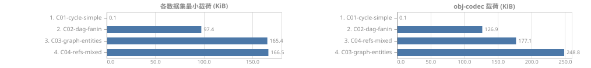

全部库的载荷体积（9 个库）

| 数据集 | v8 | msgpackr | superjson | devalue | seroval | turbo-stream | flatted | ungap-structured-clone | obj-codec |
| --- | ---: | ---: | ---: | ---: | ---: | ---: | ---: | ---: | ---: |
| C01-cycle-simple | 81B | 106B | 254B | 108B | 132B | 89B | - | 181B | 87B |
| C02-dag-fanin | 158KB | 97KB | 1023KB | 291KB | 145KB | 194KB | 271KB | 369KB | 127KB |
| C03-graph-entities | 391KB | 165KB | 809KB | 619KB | 475KB | 472KB | 589KB | 625KB | 249KB |
| C04-refs-mixed | 320KB | 166KB | 651KB | 402KB | 304KB | 349KB | 461KB | 419KB | 177KB |

gzip (level 9) 后体积：

| 数据集 | v8 | msgpackr | superjson | devalue | seroval | turbo-stream | flatted | ungap-structured-clone | obj-codec |
| --- | ---: | ---: | ---: | ---: | ---: | ---: | ---: | ---: | ---: |
| C01-cycle-simple | 93B | 102B | 159B | 110B | 133B | 101B | - | 127B | 100B |
| C02-dag-fanin | 16KB | 22KB | 53KB | 71KB | 23KB | 26KB | 48KB | 71KB | 15KB |
| C03-graph-entities | 66KB | 78KB | 95KB | 160KB | 119KB | 78KB | 112KB | 158KB | 58KB |
| C04-refs-mixed | 36KB | 37KB | 52KB | 91KB | 37KB | 38KB | 77KB | 90KB | 31KB |

### 内存（子进程，GC 后采样）

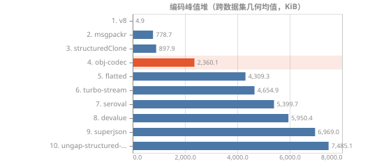

全部内存采样

| 数据集 | 库 | 编码峰值堆 | 解码峰值堆 | 结果常驻 | 进程 maxRSS |
| --- | --- | ---: | ---: | ---: | ---: |
| C01-cycle-simple | v8 | 4.9KB | 4.9KB | -18376B | 101MB |
| C01-cycle-simple | structuredClone | 5.9KB | 3.6KB | -19280B | 101MB |
| C01-cycle-simple | superjson | 44KB | 17KB | -2368B | 103MB |
| C01-cycle-simple | msgpackr | 11KB | 14KB | -600B | 102MB |
| C01-cycle-simple | devalue | 13KB | 6.6KB | -17984B | 102MB |
| C01-cycle-simple | seroval | 26KB | 131KB | -2792B | 99MB |
| C01-cycle-simple | turbo-stream | 37KB | 27KB | -25144B | 106MB |
| C01-cycle-simple | ungap-structured-clone | 20KB | 41KB | 26KB | 102MB |
| C01-cycle-simple | obj-codec | 26KB | 49KB | -6160B | 101MB |
| C02-dag-fanin | v8 | 4.9KB | 1.4MB | 606KB | 103MB |
| C02-dag-fanin | structuredClone | 1.4MB | 3.6KB | 606KB | 103MB |
| C02-dag-fanin | superjson | 19MB | 6.9MB | 1.5MB | 141MB |
| C02-dag-fanin | msgpackr | 1.4MB | 2.4MB | 451KB | 104MB |
| C02-dag-fanin | devalue | 6.0MB | 3.9MB | 1.6MB | 118MB |
| C02-dag-fanin | seroval | 8.4MB | 1.8MB | 1.7MB | 122MB |
| C02-dag-fanin | turbo-stream | 3.4MB | 2.9MB | 826KB | 124MB |
| C02-dag-fanin | flatted | 3.0MB | 8.9MB | 2.1MB | 113MB |
| C02-dag-fanin | ungap-structured-clone | 15MB | 13MB | 977KB | 127MB |
| C02-dag-fanin | obj-codec | 7.2MB | 7.6MB | 639KB | 114MB |
| C03-graph-entities | v8 | 4.9KB | 2.2MB | 886KB | 105MB |
| C03-graph-entities | structuredClone | 2.2MB | 3.6KB | 885KB | 104MB |
| C03-graph-entities | superjson | 21MB | 10.0MB | 1.5MB | 155MB |
| C03-graph-entities | msgpackr | 1.6MB | 3.6MB | 820KB | 108MB |
| C03-graph-entities | devalue | 19MB | 5.8MB | 1.4MB | 132MB |
| C03-graph-entities | seroval | 17MB | 3.3MB | 3.0MB | 148MB |
| C03-graph-entities | turbo-stream | 8.8MB | 7.4MB | 1.6MB | 126MB |
| C03-graph-entities | flatted | 4.8MB | 13MB | 2.6MB | 120MB |
| C03-graph-entities | ungap-structured-clone | 21MB | 17MB | 1.6MB | 143MB |
| C03-graph-entities | obj-codec | 2.1MB | 2.1MB | 1.2MB | 121MB |
| C04-refs-mixed | v8 | 4.9KB | 1.7MB | 1.1MB | 110MB |
| C04-refs-mixed | structuredClone | 1.7MB | 3.6KB | 1009KB | 111MB |
| C04-refs-mixed | superjson | 11MB | 3.9MB | 1.4MB | 140MB |
| C04-refs-mixed | msgpackr | 1.3MB | 2.2MB | 1.0MB | 113MB |
| C04-refs-mixed | devalue | 12MB | 3.6MB | 2.0MB | 123MB |
| C04-refs-mixed | seroval | 9.8MB | 1.8MB | 1.7MB | 127MB |
| C04-refs-mixed | turbo-stream | 12MB | 6.4MB | 2.0MB | 128MB |
| C04-refs-mixed | flatted | 4.7MB | 11MB | 2.4MB | 121MB |
| C04-refs-mixed | ungap-structured-clone | 16MB | 14MB | 1.7MB | 136MB |
| C04-refs-mixed | obj-codec | 6.5MB | 10MB | 1.3MB | 116MB |

### 失败与不保真

| 数据集 | 库 | 状态 | 说明 |
| --- | --- | --- | --- |
| C01-cycle-simple | flatted | fidelity-fail | map cycle identity |

## 套件 S3

### 汇总（跨数据集几何均值）

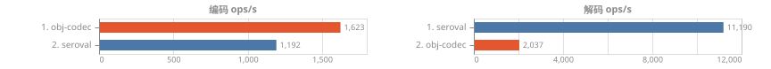

汇总数值

| 库 | 编码 ops/s | 解码 ops/s | 参与数据集 | 失败 |
| --- | ---: | ---: | ---: | ---: |
| obj-codec | 1,563 | 1,099 | 4 | 0 |
| seroval | 1,205 | 11,530 | 2 | 0 |

### 分数据集吞吐

分数据集明细（4 个数据集，各含图表与完整数值）

**D01-symbols — Symbol 密集 2e3**

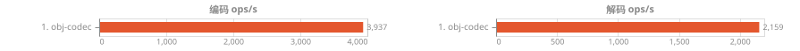

| 库 | 编码 ops/s | 解码 ops/s | 编码 MB/s | 解码 MB/s | enc p75 (ms) | dec p75 (ms) | 样本 | enc RME |
| --- | ---: | ---: | ---: | ---: | ---: | ---: | ---: | ---: |
| obj-codec | 3,937 | 2,159 | 91.93 | 50.42 | 0.246 | 0.406 | 985 | 1.5% |

**D02-unique-pointers — Unique Pointer（globalThis / 内建 Symbol / 单例）5e3 处引用**

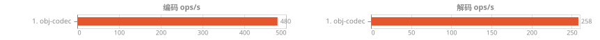

| 库 | 编码 ops/s | 解码 ops/s | 编码 MB/s | 解码 MB/s | enc p75 (ms) | dec p75 (ms) | 样本 | enc RME |
| --- | ---: | ---: | ---: | ---: | ---: | ---: | ---: | ---: |
| obj-codec | 480 | 258 | 55.11 | 29.68 | 2.115 | 3.886 | 120 | 6.0% |

**D03-custom-class-primitive — 自定义类（primitive payload）5e3 实例**

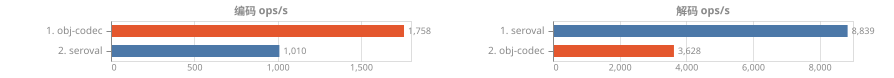

| 库 | 编码 ops/s | 解码 ops/s | 编码 MB/s | 解码 MB/s | enc p75 (ms) | dec p75 (ms) | 样本 | enc RME |
| --- | ---: | ---: | ---: | ---: | ---: | ---: | ---: | ---: |
| obj-codec | 1,809 | 2,088 | 81.48 | 94.06 | 0.530 | 0.467 | 453 | 2.1% |
| seroval | 1,025 | 9,076 | 86.39 | 764.97 | 0.936 | 0.110 | 257 | 3.0% |

**D04-custom-class-container — 自定义类（container payload）3e3 节点**

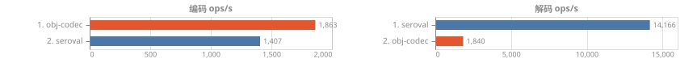

| 库 | 编码 ops/s | 解码 ops/s | 编码 MB/s | 解码 MB/s | enc p75 (ms) | dec p75 (ms) | 样本 | enc RME |
| --- | ---: | ---: | ---: | ---: | ---: | ---: | ---: | ---: |
| obj-codec | 1,748 | 1,253 | 98.95 | 70.91 | 0.558 | 0.812 | 437 | 2.3% |
| seroval | 1,417 | 14,649 | 154.27 | 1594.90 | 0.675 | 0.067 | 355 | 2.4% |

### 载荷体积

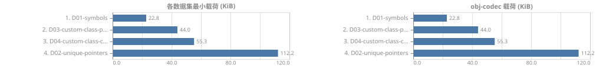

全部库的载荷体积（2 个库）

| 数据集 | seroval | obj-codec |
| --- | ---: | ---: |
| D01-symbols | - | 23KB |
| D02-unique-pointers | - | 112KB |
| D03-custom-class-primitive | 82KB | 44KB |
| D04-custom-class-container | 106KB | 55KB |

gzip (level 9) 后体积：

| 数据集 | seroval | obj-codec |
| --- | ---: | ---: |
| D01-symbols | - | 4.5KB |
| D02-unique-pointers | - | 9.6KB |
| D03-custom-class-primitive | 11KB | 8.8KB |
| D04-custom-class-container | 16KB | 18KB |

### 内存（子进程，GC 后采样）

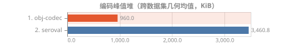

全部内存采样

| 数据集 | 库 | 编码峰值堆 | 解码峰值堆 | 结果常驻 | 进程 maxRSS |
| --- | --- | ---: | ---: | ---: | ---: |
| D01-symbols | obj-codec | 566KB | 1.4MB | 114KB | 104MB |
| D02-unique-pointers | obj-codec | 3.5MB | 5.0MB | 405KB | 113MB |
| D03-custom-class-primitive | seroval | 3.8MB | 582KB | 535KB | 107MB |
| D03-custom-class-primitive | obj-codec | 681KB | 2.9MB | 235KB | 105MB |
| D04-custom-class-container | seroval | 3.0MB | 465KB | 452KB | 104MB |
| D04-custom-class-container | obj-codec | 951KB | 2.9MB | 257KB | 103MB |

## 套件 S5 · 伸缩

### 伸缩曲线 (S5)

单次操作耗时 (ms)，单发模式：每个 case 只测一次编码与一次解码。图为等距双对数坐标，越靠近左下越好；斜率是 log-log 最小二乘拟合，1 表示线性、2 表示平方。

**形状 ints**

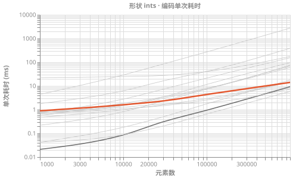

形状 ints · 完整数值与斜率

| 库 | 指标 | 1,000 | 10,000 | 30,000 | 100,000 | 1,000,000 | 斜率 |
| --- | --- | ---: | ---: | ---: | ---: | ---: | ---: |
| json | encode | 0.02 | 0.10 | 0.32 | 1.00 | 9.06 | 0.89 |
| json | decode | 0.03 | 0.09 | 0.29 | 0.94 | 7.74 | 0.82 |
| v8 | encode | 0.05 | 0.09 | 0.20 | 0.67 | 5.82 | 0.71 |
| v8 | decode | 0.07 | 0.15 | 0.43 | 1.36 | 11.65 | 0.77 |
| structuredClone | encode | 0.04 | 0.17 | 0.71 | 1.83 | 17.31 | 0.89 |
| structuredClone | decode | x | x | x | x | x | - |
| superjson | encode | 1.73 | 6.31 | 16.79 | 41.09 | 399.23 | 0.79 |
| superjson | decode | 0.06 | 0.13 | 0.41 | 0.80 | 7.01 | 0.69 |
| cbor-x | encode | 0.63 | 1.15 | 1.74 | 2.46 | 13.85 | 0.44 |
| cbor-x | decode | 0.48 | 1.05 | 1.29 | 2.56 | 14.69 | 0.49 |
| msgpackr | encode | 0.71 | 1.25 | 2.42 | 1.92 | 7.62 | 0.33 |
| msgpackr | decode | 0.43 | 0.87 | 1.41 | 2.06 | 6.80 | 0.40 |
| msgpack | encode | 0.49 | 1.01 | 1.67 | 2.79 | 14.98 | 0.49 |
| msgpack | decode | 0.64 | 1.08 | 1.45 | 2.54 | 8.13 | 0.37 |
| devalue | encode | 0.79 | 2.80 | 7.19 | 21.43 | 161.69 | 0.78 |
| devalue | decode | 0.46 | 1.04 | 2.11 | 4.80 | 18.43 | 0.55 |
| seroval | encode | 0.76 | 1.47 | 2.30 | 10.27 | 120.32 | 0.74 |
| seroval | decode | 0.15 | 0.51 | 1.29 | 4.36 | 38.62 | 0.82 |
| turbo-stream | encode | 22.19 | 23.86 | 27.94 | 39.46 | 174.06 | 0.29 |
| turbo-stream | decode | 1.44 | 2.44 | 4.82 | 10.74 | 87.69 | 0.60 |
| flatted | encode | 0.20 | 0.80 | 2.29 | 7.48 | 71.13 | 0.86 |
| flatted | decode | 0.64 | 3.88 | 11.58 | 36.86 | 428.42 | 0.95 |
| ungap-structured-clone | encode | 0.59 | 1.90 | 3.41 | 7.88 | 58.12 | 0.66 |
| ungap-structured-clone | decode | 0.47 | 1.52 | 3.05 | 7.44 | 49.48 | 0.68 |
| bson | encode | 0.81 | 1.54 | 3.03 | 7.77 | 67.36 | 0.65 |
| bson | decode | 0.78 | 1.67 | 2.37 | 4.58 | 20.03 | 0.47 |
| ion-js | encode | 4.54 | 28.56 | 78.17 | 284.72 | 2.8s | 0.94 |
| ion-js | decode | 2.90 | 10.36 | 26.45 | 73.91 | 832.37 | 0.82 |
| obj-codec | encode | 1.00 | 1.82 | 2.67 | 5.17 | 24.42 | 0.46 |
| obj-codec | decode | 1.55 | 3.14 | 6.15 | 13.74 | 103.38 | 0.61 |

**形状 records**

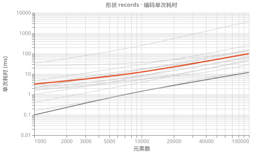

形状 records · 完整数值与斜率

| 库 | 指标 | 1,000 | 10,000 | 30,000 | 100,000 | 斜率 |
| --- | --- | ---: | ---: | ---: | ---: | ---: |
| json | encode | 0.10 | 1.41 | 3.99 | 11.95 | 1.05 |
| json | decode | 0.28 | 2.50 | 5.94 | 18.35 | 0.91 |
| v8 | encode | 0.16 | 1.35 | 4.70 | 14.30 | 0.98 |
| v8 | decode | 0.32 | 2.48 | 8.51 | 37.33 | 1.03 |
| structuredClone | encode | 0.40 | 3.95 | 12.86 | 49.55 | 1.04 |
| structuredClone | decode | x | x | x | x | - |
| superjson | encode | 4.58 | 29.58 | 75.54 | 254.19 | 0.86 |
| superjson | decode | 0.30 | 2.54 | 5.71 | 16.38 | 0.86 |
| cbor-x | encode | 1.63 | 5.14 | 13.57 | 42.39 | 0.70 |
| cbor-x | decode | 1.23 | 3.97 | 9.35 | 37.83 | 0.72 |
| msgpackr | encode | 1.57 | 5.62 | 9.91 | 28.77 | 0.61 |
| msgpackr | decode | 1.00 | 1.96 | 4.10 | 10.72 | 0.50 |
| msgpack | encode | 1.83 | 8.26 | 20.63 | 62.60 | 0.76 |
| msgpack | decode | 2.42 | 6.64 | 13.99 | 43.71 | 0.61 |
| devalue | encode | 2.23 | 16.06 | 41.42 | 146.44 | 0.90 |
| devalue | decode | 1.24 | 5.42 | 12.44 | 35.16 | 0.72 |
| seroval | encode | 2.67 | 17.91 | 34.63 | 105.09 | 0.79 |
| seroval | decode | 0.92 | 9.99 | 32.25 | 104.09 | 1.03 |
| turbo-stream | encode | 24.73 | 36.35 | 61.64 | 126.31 | 0.34 |
| turbo-stream | decode | 2.63 | 11.52 | 32.53 | 109.97 | 0.80 |
| flatted | encode | 0.98 | 7.91 | 29.46 | 103.44 | 1.01 |
| flatted | decode | 2.84 | 33.16 | 86.41 | 287.30 | 1.00 |
| ungap-structured-clone | encode | 2.08 | 16.62 | 47.65 | 153.10 | 0.93 |
| ungap-structured-clone | decode | 1.70 | 13.57 | 27.98 | 121.85 | 0.90 |
| bson | encode | 2.15 | 8.15 | 21.39 | 70.48 | 0.75 |
| bson | decode | 2.22 | 8.66 | 17.59 | 51.29 | 0.67 |
| ion-js | encode | 32.75 | 249.94 | 883.69 | 3.7s | 1.02 |
| ion-js | decode | 12.76 | 78.46 | 184.12 | 624.30 | 0.83 |
| obj-codec | encode | 3.20 | 12.45 | 32.05 | 99.37 | 0.74 |
| obj-codec | decode | 3.95 | 18.92 | 47.16 | 118.58 | 0.74 |

**形状 objects**

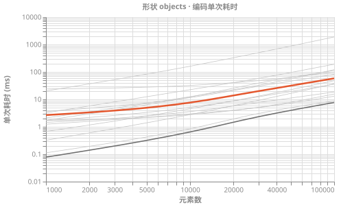

形状 objects · 完整数值与斜率

| 库 | 指标 | 1,000 | 10,000 | 30,000 | 100,000 | 斜率 |
| --- | --- | ---: | ---: | ---: | ---: | ---: |
| json | encode | 0.08 | 0.72 | 2.35 | 7.88 | 0.99 |
| json | decode | 0.12 | 0.94 | 2.94 | 11.27 | 0.97 |
| v8 | encode | 0.11 | 0.83 | 3.04 | 9.16 | 0.96 |
| v8 | decode | 0.26 | 1.90 | 6.51 | 26.67 | 1.00 |
| structuredClone | encode | 0.31 | 2.85 | 9.30 | 41.64 | 1.06 |
| structuredClone | decode | x | x | x | x | - |
| superjson | encode | 3.22 | 22.44 | 57.07 | 184.98 | 0.87 |
| superjson | decode | 0.17 | 0.97 | 2.97 | 11.80 | 0.91 |
| cbor-x | encode | 1.26 | 2.67 | 5.12 | 15.91 | 0.53 |
| cbor-x | decode | 0.90 | 2.29 | 5.45 | 17.13 | 0.62 |
| msgpackr | encode | 1.25 | 2.98 | 4.55 | 13.53 | 0.49 |
| msgpackr | decode | 0.88 | 1.43 | 2.32 | 6.72 | 0.42 |
| msgpack | encode | 1.41 | 3.69 | 7.79 | 18.17 | 0.55 |
| msgpack | decode | 1.81 | 3.27 | 6.04 | 14.69 | 0.44 |
| devalue | encode | 2.12 | 11.92 | 37.51 | 126.04 | 0.88 |
| devalue | decode | 0.91 | 3.94 | 10.72 | 32.22 | 0.77 |
| seroval | encode | 2.36 | 11.62 | 21.77 | 74.96 | 0.73 |
| seroval | decode | 0.53 | 6.19 | 18.31 | 63.27 | 1.04 |
| turbo-stream | encode | 23.76 | 32.53 | 52.07 | 99.83 | 0.30 |
| turbo-stream | decode | 2.11 | 7.00 | 18.20 | 53.23 | 0.69 |
| flatted | encode | 0.66 | 4.47 | 12.96 | 47.43 | 0.92 |
| flatted | decode | 1.82 | 15.71 | 57.20 | 177.06 | 1.00 |
| ungap-structured-clone | encode | 1.77 | 12.20 | 37.67 | 121.85 | 0.92 |
| ungap-structured-clone | decode | 1.31 | 9.01 | 27.08 | 98.51 | 0.93 |
| bson | encode | 1.72 | 5.02 | 12.41 | 36.29 | 0.65 |
| bson | decode | 1.42 | 3.29 | 7.93 | 19.24 | 0.56 |
| ion-js | encode | 20.35 | 162.57 | 492.31 | 2.0s | 0.99 |
| ion-js | decode | 7.99 | 48.92 | 132.70 | 423.12 | 0.86 |
| obj-codec | encode | 2.60 | 8.64 | 23.66 | 77.53 | 0.73 |
| obj-codec | decode | 2.90 | 12.49 | 32.50 | 72.43 | 0.71 |

## 套件 S4 · 分块传输

载荷先整体编码一次，再按固定大小切块交给解码器。`incremental` 逐块喂给解码器，`buffered` 先拼接再解码（对照组）。图为解码耗时，越短越好；展开可见各档 chunk 的中位数与采样峰值堆。

**A03-short-strings** · 载荷 86KB · 整块 chunk 数 1

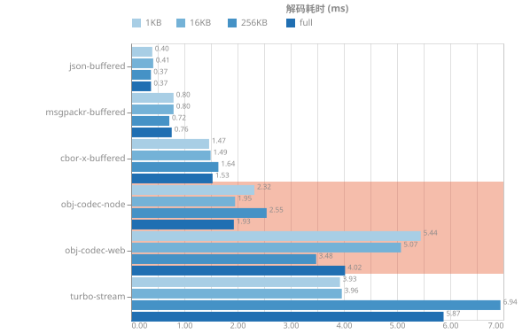

A03-short-strings · 各 chunk 大小的耗时与峰值堆

| 实现 | 模式 | 1KB | 16KB | 256KB | full |
| --- | --- | ---: | ---: | ---: | ---: |
| obj-codec-node | incremental | 4.29ms (6.4MB) | 6.84ms (6.9MB) | 5.05ms (6.1MB) | 4.99ms (6.1MB) |
| obj-codec-web | incremental | 4.73ms (7.0MB) | 4.71ms (7.5MB) | 5.77ms (6.6MB) | 5.96ms (6.3MB) |
| turbo-stream | incremental | 4.10ms (2.8MB) | 3.78ms (2.8MB) | 6.05ms (2.7MB) | 6.49ms (2.7MB) |
| cbor-x-buffered | buffered | 1.50ms (756KB) | 1.55ms (742KB) | 1.49ms (728KB) | 1.53ms (740KB) |
| msgpackr-buffered | buffered | 0.74ms (526KB) | 0.80ms (505KB) | 0.80ms (503KB) | 0.73ms (503KB) |
| json-buffered | buffered | 0.42ms (525KB) | 0.42ms (524KB) | 0.37ms (370KB) | 0.37ms (370KB) |

**A04-long-text** · 载荷 950KB · 整块 chunk 数 1

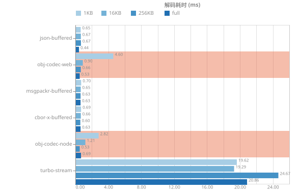

A04-long-text · 各 chunk 大小的耗时与峰值堆

| 实现 | 模式 | 1KB | 16KB | 256KB | full |
| --- | --- | ---: | ---: | ---: | ---: |
| obj-codec-node | incremental | 3.15ms (2.0MB) | 0.74ms (1.2MB) | 0.57ms (1.1MB) | 0.48ms (1.1MB) |
| obj-codec-web | incremental | 4.77ms (4.4MB) | 0.95ms (1.7MB) | 0.70ms (1.4MB) | 0.55ms (1.4MB) |
| turbo-stream | incremental | 19.98ms (30MB) | 19.23ms (30MB) | 24.62ms (30MB) | 19.92ms (30MB) |
| cbor-x-buffered | buffered | 0.71ms (1.1MB) | 0.65ms (1.1MB) | 0.64ms (1.0MB) | 0.66ms (1.0MB) |
| msgpackr-buffered | buffered | 0.69ms (1.1MB) | 0.63ms (1.1MB) | 0.62ms (1.1MB) | 0.64ms (1.1MB) |
| json-buffered | buffered | 0.65ms (2.0MB) | 0.66ms (2.0MB) | 0.66ms (2.0MB) | 0.43ms (1.0MB) |

**A09-mixed-payload** · 载荷 276KB · 整块 chunk 数 1

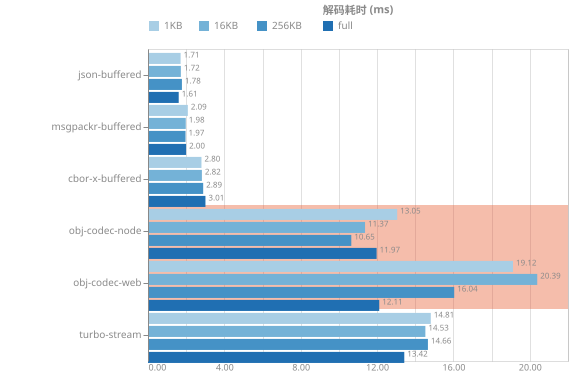

A09-mixed-payload · 各 chunk 大小的耗时与峰值堆

| 实现 | 模式 | 1KB | 16KB | 256KB | full |
| --- | --- | ---: | ---: | ---: | ---: |
| obj-codec-node | incremental | 13.05ms (6.1MB) | 11.37ms (7.4MB) | 10.65ms (5.8MB) | 11.97ms (5.1MB) |
| obj-codec-web | incremental | 19.12ms (9.1MB) | 20.39ms (10MB) | 16.04ms (7.6MB) | 12.11ms (5.3MB) |
| turbo-stream | incremental | 14.81ms (13MB) | 14.53ms (13MB) | 14.66ms (13MB) | 13.42ms (13MB) |
| cbor-x-buffered | buffered | 2.80ms (2.4MB) | 2.82ms (2.3MB) | 2.89ms (2.3MB) | 3.01ms (2.3MB) |
| msgpackr-buffered | buffered | 2.09ms (1.4MB) | 1.98ms (1.4MB) | 1.97ms (1.4MB) | 2.00ms (1.4MB) |
| json-buffered | buffered | 1.71ms (1.4MB) | 1.72ms (1.4MB) | 1.78ms (1.4MB) | 1.61ms (848KB) |

**B04-binary** · 载荷 1.0MB · 整块 chunk 数 1

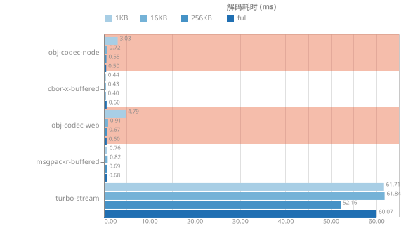

B04-binary · 各 chunk 大小的耗时与峰值堆

| 实现 | 模式 | 1KB | 16KB | 256KB | full |
| --- | --- | ---: | ---: | ---: | ---: |
| obj-codec-node | incremental | 3.03ms (1.2MB) | 0.72ms (283KB) | 0.55ms (195KB) | 0.50ms (183KB) |
| obj-codec-web | incremental | 4.79ms (3.7MB) | 0.91ms (771KB) | 0.67ms (541KB) | 0.60ms (506KB) |
| turbo-stream | incremental | 61.71ms (44MB) | 61.84ms (44MB) | 52.16ms (44MB) | 60.07ms (44MB) |
| cbor-x-buffered | buffered | 0.44ms (213KB) | 0.43ms (130KB) | 0.40ms (124KB) | 0.60ms (125KB) |
| msgpackr-buffered | buffered | 0.76ms (219KB) | 0.82ms (135KB) | 0.69ms (129KB) | 0.68ms (129KB) |

**B07-everything** · 载荷 45KB · 整块 chunk 数 1

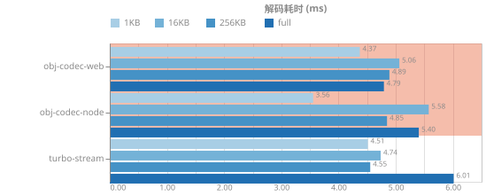

B07-everything · 各 chunk 大小的耗时与峰值堆

| 实现 | 模式 | 1KB | 16KB | 256KB | full |
| --- | --- | ---: | ---: | ---: | ---: |
| obj-codec-node | incremental | 3.56ms (5.7MB) | 5.58ms (5.5MB) | 4.85ms (5.1MB) | 5.40ms (5.1MB) |
| obj-codec-web | incremental | 4.37ms (6.1MB) | 5.06ms (5.8MB) | 4.89ms (5.4MB) | 4.79ms (5.4MB) |
| turbo-stream | incremental | 4.51ms (2.9MB) | 4.74ms (2.9MB) | 4.55ms (2.8MB) | 6.01ms (2.8MB) |

## 库自身体积

口径：esbuild (bundle, minify, platform=node, esm, node:* external)；压缩为 gzip level 9, brotli quality 11。平台内建（JSON / v8 / structuredClone）不参与。

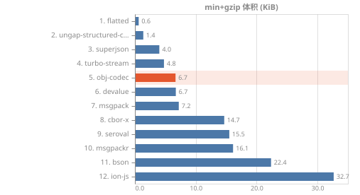

全部体积与冷启动数据

| 库 | min | min+gzip | min+brotli | 运行时依赖 | native addon | 冷启动 import |
| --- | ---: | ---: | ---: | ---: | --- | ---: |
| flatted | 1.1KB | 636B | 593B | 0 | - | 3.3ms |
| ungap-structured-clone | 3.0KB | 1.4KB | 1.2KB | 0 | - | 4.0ms |
| superjson | 11KB | 4.0KB | 3.7KB | 0 | - | 5.9ms |
| turbo-stream | 14KB | 4.8KB | 4.3KB | 0 | - | 3.7ms |
| obj-codec | 20KB | 6.7KB | 6.0KB | - | - | 5.3ms |
| devalue | 19KB | 6.7KB | 6.1KB | 0 | - | 5.6ms |
| msgpack | 27KB | 7.2KB | 6.5KB | 0 | - | 5.1ms |
| cbor-x | 39KB | 15KB | 13KB | 0 | cbor-extract | 9.5ms |
| seroval | 51KB | 16KB | 14KB | 0 | - | 4.8ms |
| msgpackr | 44KB | 16KB | 15KB | 0 | - | 9.9ms |
| bson | 75KB | 22KB | 20KB | 0 | - | 7.1ms |
| ion-js | 129KB | 33KB | 28KB | 0 | - | 17.5ms |

## 库配置

| 库 | 版本 | 线格式 | 配置 |
| --- | --- | --- | --- |
| json | v24.16.0 | text | `{"api":"JSON.stringify/parse"}` |
| v8 | v24.16.0 | binary | `{"api":"v8.serialize/deserialize","nodeOnly":true}` |
| structuredClone | v24.16.0 | memory | `{"api":"structuredClone","inMemoryOnly":true}` |
| superjson | 2.2.6 | text | `{}` |
| cbor-x | 1.6.8 | binary | `{"useRecords":"default (true)"}` |
| msgpackr | 2.1.2 | binary | `{"structuredClone":true,"nativeAddon":true}` |
| msgpack | 3.1.3 | binary | `{"useBigInt64":true,"spec":"MessagePack"}` |
| devalue | 6.0.3 | js-expression | `{}` |
| seroval | 1.7.2 | js-expression | `{"note":"serialize() refuses typed arrays above ~1e6 bytes (DEFAULT_MAX_BASE64_LENGTH); the encode side is not configurable"}` |
| turbo-stream | 3.2.1 | text | `{"transport":"ReadableStream of string chunks","symbolSupport":false}` |
| flatted | 3.4.4 | text | `{}` |
| ungap-structured-clone | 1.4.0 | text | `{"entry":"@ungap/structured-clone/json","note":"the base entry returns a JS structure, not a wire format; the /json entry is the transport form, and it maps NaN/Infinity to null"}` |
| bson | 7.3.3 | binary | `{"api":"bson.serialize({v})","spec":"BSON"}` |
| ion-js | 5.2.1 | binary | `{"spec":"Ion binary"}` |
| obj-codec | 2.0.0 | binary | `{"api":"Codec.encodeSync/decodeSync","build":"dist/index.esm.js"}` |
