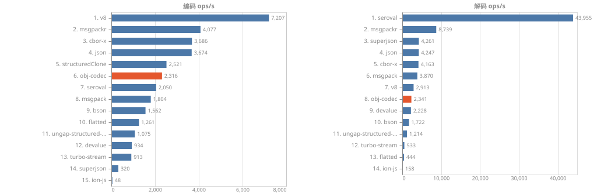
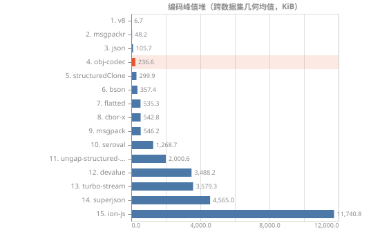
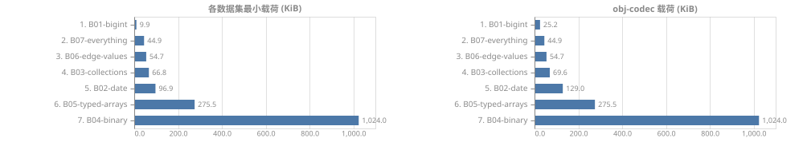

[简体中文](readme.zh-CN.md) | [English](readme.md)
# obj-codec


A binary codec for JavaScript values: reference fidelity, near-complete type coverage, and chunkable streaming.

## Installation
```sh
npm install obj-codec
# or
yarn add obj-codec
# or
pnpm add obj-codec
```

## Features
- Coverage: primitive values, Array/Set/Map, Date/RegExp/Symbol, 12 TypedArrays + ArrayBuffer/DataView, sparse arrays and holes
- References: shared references, circular references, external references
- Extensibility: support custom scalar/container codecs
- Streaming
- Compatibility:
  - Node.js v22
  - API: ES2020
  - Syntax: ES2022
- Size: min 21KB / gzip 6.8KB, zero runtime dependencies

## Capability Table
| Library          | Coverage | Gaps                                         |
| ---------------- | -------: | -------------------------------------------- |
| **obj-codec**    |    30/32 | Error, lone surrogates                       |
| seroval          |    30/32 | Symbol, deep nesting (1000 levels)           |
| structuredClone  |    30/32 | Symbol, custom classes                       |
| v8               |    30/32 | Symbol, custom classes                       |
| devalue          |    29/32 | Symbol, custom classes, Error                |
| @ungap/sc        |    29/32 | Symbol, sparse arrays, custom classes        |
| turbo-stream     |    28/32 | Symbol, sparse arrays, custom classes, Error |
| msgpackr(sc)     |    27/32 | -0, Symbol, sparse arrays, etc.              |
| superjson        |    26/32 | BigInt64Array, ArrayBuffer, DataView, etc.   |
| cbor-x           |    21/32 | -0, ArrayBuffer, DataView, etc.              |
| @msgpack/msgpack |    11/32 | undefined, bigint>64bit, -0, etc.            |
| bson             |    11/32 | undefined, bigint, bigint>64bit, etc.        |
| flatted          |    10/32 | undefined, bigint, bigint>64bit, etc.        |
| JSON             |     7/32 | undefined, bigint, bigint>64bit, etc.        |
| ion-js           |     3/32 | undefined, bigint, bigint>64bit, etc.        |

[Full capability matrix](./benchmark/capability/matrix.txt)

## Benchmarks




[More benchmark reports](./benchmark/results/report.md)

## Usage

### Synchronous API
```ts
import { ObjCodec } from 'obj-codec'; // or 'obj-codec/web'

const codec = new ObjCodec();

const bytes = codec.encodeSync(target);
const result = codec.decodeSync(bytes);
```

### Node Stream API
```ts
import { ObjCodec } from 'obj-codec';

const codec = new ObjCodec();
const decoder = codec.decode();

codec.encode(target).pipe(decoder).on('finish', () => {
	const result = decoder.result;
});
```

### Web Stream API
```ts
import { ObjCodec } from 'obj-codec/web';

const codec = new ObjCodec();
const decoder = codec.decode();

await codec.encode(target).pipeTo(decoder);
const result = decoder.result;
```

## Build/Development
```sh
pnpm i
pnpm compile
pnpm test
```

## Custom Types/Codecs
Refer to [docs/custom.md](./docs/custom.md).

## Protocol
Refer to [docs/protocol.md](./docs/protocol.md).
