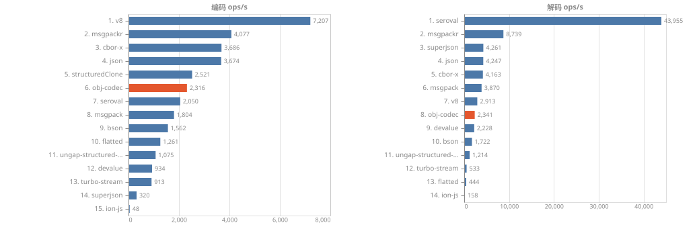
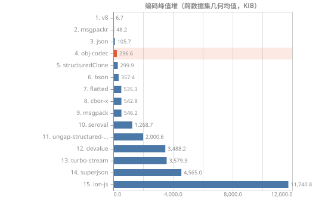
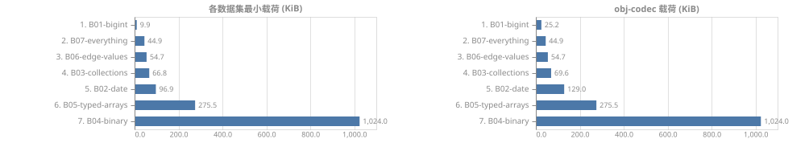

[简体中文](readme.zh-CN.md) | [English](readme.md)
# obj-codec


JavaScript 值的二进制编解码器：引用保真、类型近乎全覆盖、可分块流式。

## 安装
```sh
npm install obj-codec
# 或
yarn add obj-codec
# 或
pnpm add obj-codec
```

## 特性
- 覆盖面：原始值、Array/Set/Map、Date/RegExp/Symbol、12 种 TypedArray + ArrayBuffer/DataView、稀疏数组与空槽
- 引用：共享引用、循环引用、外部引用
- 扩展：支持自定义标量/容器编解码器
- 流式处理
- 兼容性：
  - Node.js v22
  - API：ES2020
  - 语法：ES2022
- 体积：min 21KB / gzip 6.8KB，零运行时依赖

## 能力表
| 库               |  覆盖 | 缺口                                     |
| ---------------- | ----: | ---------------------------------------- |
| **obj-codec**    | 30/32 | Error、孤立代理项                        |
| seroval          | 30/32 | Symbol、深嵌套（1000层）                 |
| structuredClone  | 30/32 | Symbol、自定义类                         |
| v8               | 30/32 | Symbol、自定义类                         |
| devalue          | 29/32 | Symbol、自定义类、Error                  |
| @ungap/sc        | 29/32 | Symbol、稀疏数组、自定义类               |
| turbo-stream     | 28/32 | Symbol、稀疏数组、自定义类、Error        |
| msgpackr(sc)     | 27/32 | -0、Symbol、稀疏数组等…                  |
| superjson        | 26/32 | BigInt64Array、ArrayBuffer、DataView 等… |
| cbor-x           | 21/32 | -0、ArrayBuffer、DataView 等…            |
| @msgpack/msgpack | 11/32 | undefined、bigint>64bit、-0 等…          |
| bson             | 11/32 | undefined、bigint、bigint>64bit 等…      |
| flatted          | 10/32 | undefined、bigint、bigint>64bit 等…      |
| JSON             |  7/32 | undefined、bigint、bigint>64bit 等…      |
| ion-js           |  3/32 | undefined、bigint、bigint>64bit 等…      |

[完整能力矩阵](./benchmark/capability/matrix.txt)

## 基准测试




[更多基准测试报告](./benchmark/results/report.md)

## 使用

### 同步 API
```ts
import { ObjCodec } from 'obj-codec'; // 或 'obj-codec/web'

const codec = new ObjCodec();

const bytes = codec.encodeSync(target);
const result = codec.decodeSync(bytes);
```

### Node Stream API
```ts
import { ObjCodec } from 'obj-codec';

const codec = new ObjCodec();
const decoder = codec.decode();

codec.encode(target).pipe(decoder).on('finish', () => {
	const result = decoder.result;
});
```

### Web Stream API
```ts
import { ObjCodec } from 'obj-codec/web';

const codec = new ObjCodec();
const decoder = codec.decode();

await codec.encode(target).pipeTo(decoder);
const result = decoder.result;
```

## 构建/开发
```sh
pnpm i
pnpm compile
pnpm test
```

## 自定义类型/编解码器
参考 [docs/custom.zh.md](./docs/custom.zh.md)。

## 协议
参考 [docs/protocol.zh.md](./docs/protocol.zh.md)。
